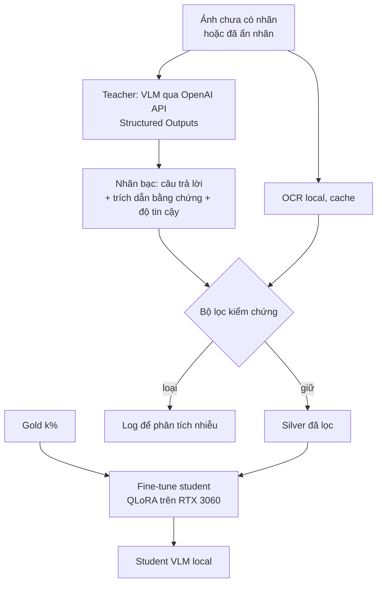
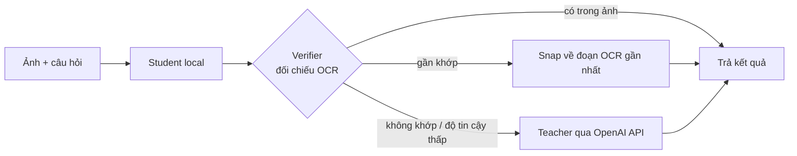

# ViDocLens — Hiểu chứng từ tiếng Việt đa phương thức bằng chưng cất có kiểm chứng

> **Tên tạm (working name).** Đây là tài liệu *source of truth* cho ý tưởng và kế hoạch của project. Mọi thay đổi về phạm vi, dữ liệu, mô hình, phương pháp đều được cập nhật vào đây và ghi vào [Nhật ký quyết định](#18-nhật-ký-quyết-định--lịch-sử-phiên-bản). Trạng thái hằng ngày theo dõi ở `docs/STATUS.md`.

| Mục | Nội dung |
|---|---|
| Người thực hiện | Nguyễn Hữu Gia Minh |
| Phiên bản | v0.2 — 02/11/2026 |
| Trạng thái | **Phase 0 — Khởi động** (chưa viết code) |
| Thời lượng | 10 tuần + 2 tuần dự phòng (02/11/2026 → ~24/01/2027) |
| Phần cứng | PC tại nhà: i5-14400F, RTX 3060 12GB (truy cập từ xa qua laptop) |
| Tài nguyên ngoài | OpenAI API |

**Quy ước:** ⚠ = thông tin cần xác minh trước khi dùng · **[LÕI]** = phần bắt buộc, không được cắt khi trễ tiến độ.

---

## 0. Tóm tắt

Project xây dựng hệ thống đọc hiểu ảnh hóa đơn/biên lai tiếng Việt chụp bằng điện thoại: **trả lời câu hỏi tự nhiên** về nội dung ảnh và **trích xuất thông tin dạng JSON**.

Ý tưởng kỹ thuật chính: dùng mô hình đa phương thức mạnh qua **OpenAI API làm teacher** để sinh nhãn cho ảnh chưa gán nhãn, **lọc nhãn bằng cách đối chiếu với OCR** (chỉ giữ câu trả lời thực sự xuất hiện trong ảnh), rồi fine-tune một **VLM nhỏ chạy local (student)** trên GPU 12GB. Khi triển khai, student trả lời trước, bộ kiểm chứng (verifier) kiểm tra, chỉ những ca không chắc chắn mới được chuyển lên API (**cascade**). Mục tiêu: độ chính xác gần teacher, chi phí thấp, phần lớn dữ liệu không rời máy.

**Ba đầu ra:**
1. Benchmark các VLM hiện đại (API + mã nguồn mở) trên bộ hỏi đáp biên lai tiếng Việt.
2. Phương pháp chưng cất có kiểm chứng + phân tích định lượng nhiễu nhãn do teacher sinh ra.
3. Hệ thống hoàn chỉnh: API, demo, Docker, mã nguồn và báo cáo kỹ thuật.

---

## 1. Bối cảnh và động lực

- **Nhu cầu thực tế:** đọc chứng từ là bài toán hằng ngày ở fintech, ngân hàng, thương mại điện tử (hoàn tiền, đối soát, nhập liệu chi phí, eKYC).
- **Đặc thù tiếng Việt:** dấu thanh, định dạng số tiền (`1.000.000đ`, `1,000,000`), bố cục biên lai không chuẩn hóa, giấy in nhiệt bị phai, ảnh mờ/nghiêng.
- **Mâu thuẫn khi triển khai:** mô hình API mạnh nhưng tốn chi phí theo lượt và phải gửi ảnh ra ngoài; mô hình nhỏ chạy local rẻ và riêng tư nhưng yếu hơn. Câu hỏi thực tế: *làm sao có được cái tốt của cả hai?*

---

## 2. Khoảng trống nghiên cứu (Research gap)

> Dựa trên khảo sát sơ bộ ngày 02/11/2026. **Phase 0 bắt buộc xác nhận lại** bằng tìm kiếm có hệ thống (Google Scholar, arXiv, ACL Anthology, Papers with Code), đặc biệt các công trình 2025–2026 đã đánh giá MLLM trên ReceiptVQA. Nếu gap đã bị lấp, điều chỉnh mục 3 và ghi vào nhật ký quyết định.

### G1 — Khoảng trống đánh giá
**Bằng chứng:** ReceiptVQA (UIT – ĐHQG-HCM, 2025) là bộ hỏi đáp tài liệu tiếng Việt quy mô lớn đầu tiên cho biên lai: 9.500 ảnh (phần lớn chụp bằng điện thoại), 64.812 cặp hỏi–đáp gán nhãn thủ công, câu trả lời là đoạn văn bản nguyên văn trên ảnh. Các baseline được báo cáo đều thuộc thế hệ trước MLLM (PhoBERT, LayoutXLM, LiLT, ViT5, LaTr, LiGT).
**Khoảng trống:** chưa thấy đánh giá có hệ thống các VLM hiện đại — cả API thương mại lẫn VLM mã nguồn mở cỡ nhỏ — trên bộ này.

### G2 — Khoảng trống độ chính xác tuyệt đối
**Bằng chứng:** trong bài gốc, mô hình tốt nhất đạt ANLS khoảng 79% nhưng Accuracy (khớp tuyệt đối) chỉ khoảng 63%. Accuracy cho câu hỏi về địa điểm khoảng 40%, câu hỏi về số lượng khoảng 60%.
**Khoảng trống:** với chứng từ, "gần đúng" một chữ số vẫn là sai. Cần tập trung vào **khớp tuyệt đối**, đặc biệt với câu trả lời dạng số.

### G3 — Khoảng trống chất lượng nhãn sinh tự động
**Bằng chứng:** nhiều tài nguyên đa phương thức tiếng Việt gần đây được sinh bằng LLM/VLM. Các bộ dữ liệu dùng để huấn luyện Vintern-1B được tạo bằng Gemini 1.5 Flash; trong đó Viet-Receipt-VQA có khoảng 14.200 mẫu mô tả/KIE/hỏi–đáp trên 2.034 biên lai MC-OCR. AutoViVQA (2026) dùng pipeline LLM/VLM để sinh và kiểm định dữ liệu VQA tổng quát.
**Khoảng trống:** với miền chứng từ, mức nhiễu của nhãn sinh tự động (sai số, sai dấu, bịa thông tin) chưa được đo rõ, và chưa thấy cơ chế lọc dựa trên **bằng chứng hiển thị trong ảnh** được đánh giá có đối chứng.

### G4 — Khoảng trống triển khai
**Khoảng trống:** thiếu phân tích đánh đổi **độ chính xác – chi phí – độ trễ – quyền riêng tư** giữa API, mô hình local và kết hợp (cascade) cho chứng từ tiếng Việt.

### Tổng hợp

| Gap | Hướng giải quyết trong project | RQ |
|---|---|---|
| G1 | Benchmark VLM API + local trên ReceiptVQA | RQ1 |
| G3 | Chưng cất có kiểm chứng: lọc nhãn teacher bằng đối chiếu OCR | RQ2 |
| G2 | Bộ kiểm chứng lúc suy luận: "snap-to-OCR" + từ chối trả lời | RQ3 |
| G4 | Cascade local → API, đo chi phí/độ chính xác | RQ4 |

---

## 3. Mục tiêu nghiên cứu kỹ thuật chính **[LÕI]**

> **Đề xuất và đánh giá phương pháp *chưng cất có kiểm chứng* (grounded distillation) từ VLM thương mại sang VLM nhỏ chạy local cho bài toán hỏi đáp trên chứng từ tiếng Việt, sao cho student đạt độ chính xác khớp tuyệt đối gần teacher, chạy được trên GPU 12GB, và kết hợp cơ chế cascade để giảm chi phí API.**

### 3.1 Giả thuyết
- **H1.** VLM hiện đại (API) vượt kết quả tốt nhất thế hệ trước trên ReceiptVQA về ANLS, nhưng khoảng cách ANLS–Accuracy vẫn còn rõ ở câu trả lời dạng số và địa chỉ.
- **H2.** Với cùng lượng dữ liệu, student huấn luyện trên nhãn bạc **đã lọc bằng đối chiếu OCR** đạt Accuracy cao hơn student dùng nhãn bạc **chưa lọc**.
- **H3.** Bộ kiểm chứng lúc suy luận (snap-to-OCR) giảm tỉ lệ câu trả lời "không có trong ảnh" và tăng khớp tuyệt đối với mức hao hụt độ phủ nhỏ.
- **H4.** Cascade local → API đạt độ chính xác gần teacher với chi phí API chỉ bằng một phần nhỏ so với gọi API cho mọi câu hỏi.

### 3.2 Đóng góp dự kiến
- **C1.** Benchmark có đo chi phí của VLM hiện đại trên hỏi đáp biên lai tiếng Việt.
- **C2.** Phân tích định lượng nhiễu nhãn của teacher trên chứng từ tiếng Việt + bộ lọc dựa trên bằng chứng OCR (độc lập với teacher cụ thể).
- **C3.** Student VLM nhỏ + verifier chạy trên GPU phổ thông.
- **C4.** Bộ đánh giá mã nguồn mở, tái lập được.

### 3.3 Mục tiêu phụ
- **Hồ sơ:** repo công khai, demo chạy được, báo cáo kỹ thuật, câu chuyện rõ ràng khi phỏng vấn.
- **Học nghiên cứu:** đi trọn một vòng nghiên cứu — khảo sát → giả thuyết → thí nghiệm có đối chứng → phân tích → viết (xem mục "Kỹ năng" trong từng phase).

---

## 4. Câu hỏi nghiên cứu

| RQ | Câu hỏi | Giả thuyết | Phase | Thí nghiệm chính |
|---|---|---|---|---|
| RQ1 | VLM hiện đại (API và local) làm tốt đến đâu trên hỏi đáp biên lai tiếng Việt, sai ở loại câu hỏi/câu trả lời nào? | H1 | 2, 3 | A1–A5, L1 so với R0 |
| RQ2 | Lọc nhãn teacher bằng đối chiếu OCR có giúp student tốt hơn không, và nhiễu nhãn teacher là bao nhiêu? | H2 | 4 | P1 vs P2, đo độ chính xác nhãn bạc |
| RQ3 | Kiểm chứng lúc suy luận có cải thiện khớp tuyệt đối và giảm bịa thông tin không? | H3 | 5 | P3 vs P2 |
| RQ4 | Cascade đạt điểm cân bằng chính xác–chi phí như thế nào? | H4 | 5 | P4 vs A3 |

---

## 5. Định nghĩa bài toán

### Track A — Hỏi đáp trên biên lai (trọng tâm nghiên cứu) **[LÕI]**
- **Đầu vào:** một ảnh biên lai + một câu hỏi tiếng Việt.
- **Đầu ra:** đoạn văn bản nguyên văn có trên ảnh (theo định nghĩa của ReceiptVQA).
- **Ví dụ:** "Tổng tiền khách phải thanh toán là bao nhiêu?" → `125.000`

### Track B — Trích xuất thông tin JSON (trọng tâm sản phẩm)
```json
{
  "seller_name": "Cửa hàng ABC",
  "seller_address": "123 Nguyễn Văn Cừ, Q.5, TP.HCM",
  "timestamp": "2026-10-31T19:45:00",
  "total_amount": 125000,
  "currency": "VND",
  "evidence": {"total_amount": "TỔNG CỘNG: 125.000"},
  "confidence": {"total_amount": 0.97}
}
```
Schema chốt theo nhãn của MC-OCR (⚠ kiểm tra danh sách trường). Track B dùng chung student + verifier của Track A; nghiên cứu sâu là tùy chọn.

---

## 6. Dữ liệu

| Bộ dữ liệu | Vai trò | Quy mô | Truy cập | Ghi chú |
|---|---|---|---|---|
| **ReceiptVQA** | Gold chính: train/dev/test | 9.500 ảnh, 64.812 QA; split ảnh 7.600 / 950 / 950 | ⚠ Chỉ cho nghiên cứu; tác giả cung cấp theo yêu cầu → **gửi email xin dữ liệu ngay tuần 1** | Nhóm tác giả thuộc UIT (cùng ĐHQG-HCM) — có thể nhờ thầy hướng dẫn liên hệ |
| **MC-OCR 2021** | Track B (KIE); nguồn ảnh chưa gán nhãn | ~2.400 ảnh | ⚠ Kiểm tra license | **Trùng ảnh** với ReceiptVQA |
| **5CD-AI/Viet-Receipt-VQA** | Nhãn bạc có sẵn (Gemini) — đối chứng khi đo nhiễu nhãn | 2.034 ảnh, ~14.200 mẫu | Hugging Face, ⚠ license | Ảnh lấy từ MC-OCR → trùng ảnh |
| **Tự thu thập** | Test ngoài phân phối (OOD) | 150–300 ảnh, ~1.000 QA tự gán | Tự quản lý | Bắt buộc che thông tin cá nhân |

### Nguyên tắc dữ liệu
1. **Chống rò rỉ:** khử trùng lặp ảnh giữa mọi nguồn bằng perceptual hash; mọi ảnh trùng với ReceiptVQA test bị loại khỏi dữ liệu huấn luyện và sinh nhãn.
2. Split cố định, lưu file split vào repo; tập OOD **không bao giờ** dùng để huấn luyện hay chọn siêu tham số.
3. Chọn prompt và siêu tham số **chỉ trên dev**; test chạy một lần cho cấu hình cuối.
4. OCR toàn bộ ảnh **một lần**, cache kết quả, dùng chung cho mọi thí nghiệm.
5. Chuẩn hóa Unicode về NFC trước mọi so sánh chuỗi.
6. Viết data card: số ảnh, phân bố loại câu hỏi/câu trả lời, độ phân giải, tỉ lệ ảnh khó.

### Phương án dự phòng
Nếu không có ReceiptVQA trước cuối tuần 2: dùng Viet-Receipt-VQA làm nguồn silver + tự gán nhãn và rà soát thủ công 500–1.000 QA làm tập gold đánh giá. Trọng tâm nghiên cứu chuyển sang *đo và lọc nhiễu nhãn của bộ silver có sẵn* (vẫn trả lời RQ2–RQ4).

---

## 7. Phương pháp đề xuất

### 7.1 Tổng quan pha huấn luyện



### 7.2 Teacher (OpenAI API)
- Một request cho **một ảnh kèm toàn bộ câu hỏi** của ảnh đó (giảm số lượt gọi).
- Đầu ra theo schema: `{qid, answer, evidence_text, confidence}`; `evidence_text` là dòng chữ trên ảnh chứa câu trả lời.
- Hai chế độ: **trả lời câu hỏi có sẵn** (đo được nhiễu so với gold) và **tự sinh cặp hỏi–đáp** cho ảnh chưa có nhãn.
- Mọi prompt có mã phiên bản (`prompt_v1`, `prompt_v2`…) và được lưu trong repo.

### 7.3 Bộ lọc kiểm chứng (biến thể để ablation)

| Mã | Bộ lọc | Mô tả |
|---|---|---|
| F0 | Không lọc | Giữ toàn bộ nhãn teacher |
| F1 | Đối chiếu OCR | Câu trả lời số phải khớp tuyệt đối chuỗi chữ số trong OCR; câu trả lời chữ phải có đoạn OCR với khoảng cách Levenshtein chuẩn hóa ≤ τ |
| F2 | Tự nhất quán | Hai lần gọi (hai prompt khác nhau) phải cho cùng đáp án |
| F3 | F1 ∧ F2 | Kết hợp |

Trên phần dữ liệu đã ẩn nhãn, đo được **độ chính xác của nhãn bạc** và **precision/recall của bộ lọc** so với gold — đây là kết quả trực tiếp cho G3.

### 7.4 Student
- VLM cỡ ≤ 4B tham số, QLoRA 4-bit, gradient checkpointing, giới hạn số pixel ảnh đầu vào.
- Ứng viên ⚠ (chọn bản mới nhất vừa 12GB tại thời điểm làm): họ Qwen-VL cỡ 2–4B; Vintern-1B (VLM hướng tiếng Việt).
- Dữ liệu huấn luyện = gold k% + silver (theo bộ lọc).

### 7.5 Pha suy luận: verifier + cascade



- **Snap-to-OCR:** nếu câu trả lời không có nguyên văn trong OCR nhưng rất gần một đoạn OCR, thay bằng đoạn đó (sửa lỗi dấu, lệch một ký tự).
- **Cascade:** chỉ ca không qua được verifier mới gọi API. Đo tỉ lệ chuyển tầng, độ chính xác tổng, chi phí/1.000 câu hỏi.

---

## 8. Bố cục baseline

| Mã | Nhóm | Hệ thống | Vai trò |
|---|---|---|---|
| R0 | Tham chiếu | Số liệu báo cáo trong bài ReceiptVQA (LiGT, ViT5+U…) — không tái lập | Mốc thế hệ trước MLLM (G1) |
| R1 | Cận trên | MATCHED_OCR với OCR của project | Kiểm tra pipeline OCR, giới hạn của cách dựa OCR |
| A1 | API | Văn bản OCR → LLM (chỉ văn bản) | Đo đóng góp của thông tin thị giác |
| A2 | API | Ảnh → VLM zero-shot | Teacher cơ bản |
| A3 | API | Ảnh + văn bản OCR → VLM | Cấu hình lai, kỳ vọng mạnh nhất |
| A4 | API | A3 + few-shot | Ảnh hưởng của ví dụ mẫu |
| A5 | API | Model giá rẻ (bản mini/nano) với cấu hình tốt nhất | Ứng viên teacher cho sinh nhãn hàng loạt |
| L1 | Local | Student zero-shot | Điểm xuất phát |
| L2 | Local | Student fine-tune chỉ gold k%, k ∈ {5, 10, 25, 100} | Đường cong học; cận trên có giám sát |
| P1 | Đề xuất | Gold k% + silver **chưa lọc** (F0) | Ablation bộ lọc |
| **P2** | **Đề xuất** | Gold k% + silver **đã lọc** (F1/F2/F3) | **Phương pháp chính** |
| P3 | Đề xuất | P2 + snap-to-OCR | Giải G2 |
| P4 | Đề xuất | P3 + cascade lên A3 | Giải G4 |

### So sánh nào trả lời câu hỏi nào

| So sánh | Trả lời |
|---|---|
| A2/A3 vs R0 | H1 — VLM hiện đại so với thế hệ trước |
| A3 vs A1 | Thị giác đóng góp bao nhiêu ngoài OCR |
| **P2 vs P1** (cùng k) | **H2 — lọc có giúp không** |
| P2 vs L2 (cùng k) | Silver bổ sung được bao nhiêu so với chỉ gold |
| P2 vs A5/A3 | Khoảng cách student–teacher |
| P3 vs P2 | H3 — tác dụng của verifier |
| P4 vs A3 | H4 — độ chính xác và chi phí |

### Quy tắc so sánh công bằng
Cùng tập test, cùng OCR, cùng cách chuẩn hóa, chọn cấu hình trên dev, báo cáo kèm khoảng tin cậy, ghi rõ tên model và phiên bản prompt.

---

## 9. Đánh giá

### 9.1 Metric

| Nhóm | Metric | Ghi chú |
|---|---|---|
| Chính xác (so sánh được với bài gốc) | Accuracy (khớp tuyệt đối), ANLS (τ = 0.5), token F1 | Dùng đúng định nghĩa trong bài ReceiptVQA |
| Chính xác (bổ sung) | Numeric EM | Khớp tuyệt đối riêng cho câu trả lời dạng số |
| Độ trung thực | Grounded rate | Tỉ lệ câu trả lời xuất hiện trong OCR |
| Từ chối trả lời | Đường coverage–accuracy | Khi thay đổi ngưỡng verifier |
| Nhãn bạc | Độ chính xác nhãn teacher; precision/recall bộ lọc | Đo trên phần đã ẩn nhãn |
| Hệ thống | Chi phí/1.000 câu (USD), độ trễ p50/p95, VRAM đỉnh | Cho mọi hệ thống |

Phân tích theo **loại câu hỏi** (Object, Quantity, Time, Location, Person, Other) và **loại câu trả lời** (Numeric, Non-Numeric, Hybrid) — dùng lại phân loại của bài gốc để so sánh được.

### 9.2 Quy trình thống kê
- Khoảng tin cậy 95% bằng bootstrap cho mọi con số chính.
- So sánh từng cặp hệ thống bằng paired bootstrap hoặc McNemar.
- Fine-tune quan trọng (L2, P1, P2 ở k chính): chạy 3 seed nếu đủ thời gian.

### 9.3 Phân loại lỗi (error taxonomy — bản nháp)
1. **Dấu thanh:** đúng chữ cái, sai/mất dấu.
2. **Định dạng số:** nhầm dấu chấm/phẩy, thiếu/thừa chữ số.
3. **Chất lượng ảnh:** mờ, nghiêng, lóa, giấy phai.
4. **Bố cục:** nhầm hàng/cột, nhầm trường (lấy "tiền khách đưa" thay vì "tổng tiền").
5. **Bịa thông tin:** câu trả lời không có trong ảnh.
6. **Định dạng đầu ra:** sai schema, sai kiểu dữ liệu.

Mỗi hệ thống chính: lấy mẫu ngẫu nhiên lỗi, gán nhãn thủ công theo taxonomy, báo cáo tỉ lệ.

---

## 10. Tích hợp OpenAI API

| Thành phần | Dùng để | Ghi chú |
|---|---|---|
| Responses API, đầu vào ảnh | Gọi VLM với ảnh + câu hỏi | ⚠ Kiểm tra model có vision hiện hành tại trang Models |
| Structured Outputs (JSON Schema / Pydantic) | Bắt buộc đầu ra đúng schema | Dùng cho cả Track A và B |
| Batch API | Sinh nhãn bạc hàng loạt, rẻ hơn, chạy bất đồng bộ | ⚠ Kiểm tra mức giảm giá và giới hạn |
| Tham số độ phân giải ảnh | Đánh đổi chi phí – độ chính xác | ⚠ Kiểm tra tên tham số; có thể làm ablation |

### Quy tắc kỹ thuật
1. **Cache mọi phản hồi:** khóa = hash(model + phiên bản prompt + hash ảnh + tham số); lưu JSONL/SQLite. Chạy lại không tốn tiền và kết quả tái lập được.
2. **Budget guard:** ước tính chi phí trước mỗi lần chạy lớn; dừng khi vượt trần đã đặt.
3. **Retry có backoff**, log token và chi phí từng request.
4. **Ghim tên model** (snapshot) trong file cấu hình và ghi vào mọi bảng kết quả.
5. API key nằm trong `.env`, có trong `.gitignore`; không bao giờ đặt key trong notebook hay commit.
6. Chỉ gửi ảnh từ bộ dữ liệu công khai hoặc ảnh tự thu thập **đã che thông tin cá nhân**.

### ⚠ Điều khoản sử dụng
Điều khoản của OpenAI cấm dùng output để phát triển mô hình cạnh tranh với OpenAI. Một student chuyên hỏi đáp biên lai cho mục đích nghiên cứu nhiều khả năng không thuộc trường hợp này, nhưng đây là **cách hiểu cần xác nhận** với thầy hướng dẫn trước Phase 4.
**Phương án dự phòng:** phương pháp được thiết kế độc lập với teacher — có thể thay teacher ở bước sinh nhãn bằng một VLM mã nguồn mở cỡ lớn mà không đổi phần còn lại; OpenAI vẫn dùng cho baseline A1–A5 và tầng cascade.

---

## 11. Lộ trình theo phase

| Phase | Tuần | Thời gian | Trọng tâm | Mốc kiểm tra |
|---|---|---|---|---|
| 0 | 1 | 02/11 – 08/11 | Khởi động, khảo sát tài liệu | Gap xác nhận, có nguồn dữ liệu |
| 1 | 2 | 09/11 – 15/11 | Dữ liệu & bộ đánh giá | Eval harness chạy được |
| 2 | 3 | 16/11 – 22/11 | Baseline API | Bảng A1–A5 |
| 3 | 4–5 | 23/11 – 06/12 | Baseline local | Đường cong học L2 |
| **4** | **6–7** | **07/12 – 20/12** | **Chưng cất có kiểm chứng [LÕI]** | **Bảng kết quả chính (H2)** |
| 5 | 8 | 21/12 – 27/12 | Verifier, cascade, phân tích lỗi | Kết quả H3, H4 |
| 6 | 9 | 28/12 – 03/01 | Sản phẩm | Demo chạy bằng một lệnh |
| 7 | 10 | 04/01 – 10/01 | Viết báo cáo | Bản nháp gửi thầy |
| — | 11–12 | 11/01 – 24/01 | Dự phòng (thi cuối kỳ) | — |

**Thứ tự cắt khi trễ:** Track B → cascade (P4) → kích thước tập OOD → số seed. Không cắt Phase 0–4 và phần đánh giá.

### Phase 0 — Khởi động & khảo sát (Tuần 1)
- **Mục tiêu:** xác nhận gap, có quyền truy cập dữ liệu, môi trường chạy được.
- **Công việc:**
  - Gửi email xin ReceiptVQA (nếu được, qua thầy hướng dẫn); tải MC-OCR, Viet-Receipt-VQA.
  - Đọc 10–15 bài, ghi vào `docs/LITERATURE.md` theo bảng: bài – dữ liệu – phương pháp – kết quả – hạn chế.
  - Tìm công trình 2025–2026 đã đánh giá MLLM trên ReceiptVQA để chốt G1.
  - Kiểm tra model OpenAI hiện hành, bảng giá, Batch API, điều khoản sử dụng.
  - Dựng repo, môi trường CUDA, thử load một VLM 4-bit trên RTX 3060.
- **Bàn giao:** `LITERATURE.md`, `STATUS.md`, `DECISIONS.md`, ước tính ngân sách API.
- **Tiêu chí hoàn thành:** gap được xác nhận (hoặc điều chỉnh) · có ít nhất một nguồn gold · chạy được suy luận VLM local.
- **Kỹ năng nghiên cứu:** khảo sát tài liệu có hệ thống, xác định và lập luận cho gap.

### Phase 1 — Dữ liệu & bộ đánh giá (Tuần 2)
- **Mục tiêu:** có bộ đánh giá đáng tin cậy trước khi chạy bất kỳ mô hình nào.
- **Công việc:**
  - Loader, chuẩn hóa NFC, khử trùng lặp ảnh, data card.
  - Chạy OCR toàn bộ ảnh một lần và cache.
  - Cài đặt metric (Accuracy, ANLS, F1, Numeric EM, grounded rate) + bootstrap; viết unit test cho metric.
  - Tái lập R1 (MATCHED_OCR) để kiểm tra pipeline; so với con số trong bài gốc (chênh lệch phản ánh chất lượng OCR).
  - Bắt đầu thu thập và gán nhãn tập OOD.
- **Tiêu chí hoàn thành:** chạy đánh giá trên dự đoán giả, test pass, R1 có số.
- **Kỹ năng nghiên cứu:** thiết kế đánh giá, phòng tránh rò rỉ dữ liệu.

### Phase 2 — Baseline API (Tuần 3)
- **Mục tiêu:** biết teacher mạnh đến đâu và tốn bao nhiêu.
- **Công việc:**
  - Viết client OpenAI: cache, retry, budget guard, Structured Outputs.
  - Chạy A1–A4 trên một phần dev (100–200 ảnh) để chọn prompt; chạy cấu hình tốt nhất trên test.
  - Chạy A5 (model giá rẻ) để chọn teacher cho sinh nhãn hàng loạt.
- **Bàn giao:** bảng A1–A5 cạnh R0, nhật ký chi phí.
- **Tiêu chí hoàn thành:** chọn được teacher cho Phase 4; có kết quả sơ bộ cho H1.
- **Kỹ năng nghiên cứu:** thí nghiệm prompt có kiểm soát, ablation từng yếu tố.

### Phase 3 — Baseline local (Tuần 4–5)
- **Mục tiêu:** chọn student và biết student học được bao nhiêu từ gold.
- **Công việc:**
  - L1 zero-shot với 2 ứng viên → chốt student.
  - Pipeline QLoRA; chạy L2 với k ∈ {5, 10, 25, 100}.
  - Đo VRAM, độ trễ, throughput.
- **Bàn giao:** đường cong học L2, cấu hình huấn luyện chuẩn.
- **Tiêu chí hoàn thành:** fine-tune ổn định trên 12GB, có số L2 cho mọi k.
- **Kỹ năng nghiên cứu:** fine-tuning có kiểm soát, đọc đường cong học.

### Phase 4 — Chưng cất có kiểm chứng (Tuần 6–7) **[LÕI]**
- **Mục tiêu:** trả lời RQ2.
- **Công việc:**
  - Ẩn nhãn phần train ngoài k% gold; teacher trả lời các câu hỏi đó qua Batch API.
  - Teacher tự sinh hỏi–đáp cho ảnh chưa có nhãn (đã khử trùng với test).
  - Áp dụng F0–F3; đo độ chính xác nhãn bạc và precision/recall bộ lọc.
  - Huấn luyện P1, P2 với k ∈ {5, 10, 25}; thử tăng dần lượng silver.
- **Bàn giao:** bảng kết quả chính (P1 vs P2 vs L2), biểu đồ nhiễu nhãn.
- **Tiêu chí hoàn thành:** kết luận được H2 (đúng hay sai đều là kết quả).
- **Kỹ năng nghiên cứu:** thí nghiệm có đối chứng, xử lý nhãn nhiễu, chưng cất tri thức.

### Phase 5 — Verifier, cascade & phân tích lỗi (Tuần 8)
- **Mục tiêu:** trả lời RQ3, RQ4.
- **Công việc:**
  - P3 (snap-to-OCR), vẽ đường coverage–accuracy.
  - P4 (cascade), vẽ đường chính xác–chi phí.
  - Phân tích lỗi theo taxonomy, theo loại câu hỏi/câu trả lời; đánh giá trên tập OOD.
- **Tiêu chí hoàn thành:** kết luận H3, H4; bảng taxonomy có số liệu.
- **Kỹ năng nghiên cứu:** phân tích lỗi định lượng, trình bày trade-off.

### Phase 6 — Sản phẩm (Tuần 9)
- **Công việc:**
  - FastAPI: `/vqa`, `/extract`; backend chọn được `local | openai | cascade`.
  - Track B: trích xuất JSON qua Structured Outputs và qua student + verifier.
  - Demo Gradio; Docker; test; CI cơ bản.
- **Tiêu chí hoàn thành:** `docker compose up` là chạy được demo.

### Phase 7 — Viết (Tuần 10)
- **Công việc:**
  - Báo cáo kỹ thuật 4–6 trang theo cấu trúc bài hội nghị (tiếng Anh).
  - README, model card, data card.
  - (Tùy chọn) công bố trọng số student nếu license cho phép.
  - Trao đổi với thầy về nơi nộp.
- **Tiêu chí hoàn thành:** bản nháp đã được thầy góp ý.

---

## 12. Ngân sách API

**Công thức:** chi phí ≈ Σ (token ảnh + token prompt) × giá input + token output × giá output, nhân hệ số giảm nếu dùng Batch API. ⚠ Không ghi giá cứng ở đây — lấy từ bảng giá chính thức khi lập ngân sách.

| Hạng mục | Số lượt gọi ước tính |
|---|---|
| Chọn prompt trên dev (A1–A5) | ~1.500 |
| Đánh giá trên test | ~5.000 |
| Sinh nhãn bạc (1–2 lượt/ảnh) | ~7.600 – 15.000 |
| Tầng cascade (chỉ ca chuyển tầng) | ~1.000 |
| **Tổng** | **~15.000 – 22.000** |

**Cách chốt ngân sách:** chạy thử 50 ảnh → đo token thực tế → nhân lên → ghi trần ngân sách vào `DECISIONS.md`. Dùng model giá rẻ cho sinh nhãn hàng loạt, model mạnh chỉ cho đánh giá.

---

## 13. Cấu trúc repo dự kiến

```
vidoclens/
├── README.md
├── docs/
│   ├── PROJECT_OVERVIEW.md      # tài liệu này
│   ├── STATUS.md                # đang làm gì, việc kế tiếp, vướng mắc
│   ├── DECISIONS.md             # nhật ký quyết định chi tiết
│   ├── LITERATURE.md            # bảng khảo sát tài liệu
│   └── experiments/             # mỗi thí nghiệm một file: cấu hình, commit, kết quả, nhận xét
├── configs/                     # data / ocr / teacher / student / eval
├── data/                        # (gitignore) raw/, processed/, splits/, ocr_cache/
├── cache/                       # (gitignore) phản hồi API đã cache
├── src/vidoclens/
│   ├── data/                    # loader, chuẩn hóa, khử trùng lặp
│   ├── ocr/                     # chạy và cache OCR
│   ├── teacher/                 # client OpenAI, prompt có phiên bản, batch, cache, budget guard
│   ├── filtering/               # bộ lọc F0–F3
│   ├── student/                 # QLoRA fine-tuning, suy luận
│   ├── verify/                  # snap-to-OCR, cascade
│   ├── eval/                    # metric, bootstrap, phân tích lỗi
│   └── serving/                 # FastAPI
├── app/                         # demo Gradio
├── scripts/                     # chạy từng thí nghiệm
├── notebooks/                   # khám phá dữ liệu, phân tích lỗi
├── tests/
├── .env.example                 # OPENAI_API_KEY=... (không chứa key thật)
├── Dockerfile
└── pyproject.toml
```

**Quy ước thí nghiệm:** mỗi lần chạy có mã (`EXP-A3-001`, `EXP-P2-k10-003`…), ghi lại commit, cấu hình, tên model, phiên bản prompt, kết quả và chi phí.

---

## 14. Rủi ro và phương án

| Rủi ro | Mức độ | Phương án |
|---|---|---|
| Không nhận được ReceiptVQA kịp thời | Cao | Kích hoạt phương án dự phòng ở mục 6 từ cuối tuần 2 |
| Gap G1 đã có người lấp | Trung bình | Chuyển trọng tâm sang G3 (nhiễu nhãn + bộ lọc) — vẫn đứng vững |
| Rò rỉ dữ liệu do ảnh MC-OCR trùng giữa các bộ | Cao | Khử trùng lặp bằng perceptual hash trước mọi thí nghiệm |
| Điều khoản OpenAI không cho dùng output để huấn luyện | Trung bình | Xác nhận với thầy; thay teacher bằng VLM mã nguồn mở cho bước sinh nhãn |
| Vượt ngân sách API | Trung bình | Cache, Batch API, model giá rẻ, budget guard, chạy thử trước |
| Student không vừa 12GB | Trung bình | Giảm số pixel ảnh, giảm rank LoRA, chọn model nhỏ hơn |
| Lọc nhãn không giúp (H2 sai) | Trung bình | Vẫn là kết quả có giá trị; phân tích vì sao (nhiễu thấp? bộ lọc loại nhầm?) |
| Trễ do lịch học/thi | Cao | 2 tuần dự phòng + thứ tự cắt đã định ở mục 11 |
| Lộ thông tin cá nhân trong ảnh tự thu thập | Trung bình | Che trước khi lưu và trước khi gửi API; không công khai ảnh gốc |

---

## 15. Quyết định cần chốt

- [ ] Student chính (sau L1 zero-shot).
- [ ] OCR engine (PaddleOCR + VietOCR hay lựa chọn khác) — ảnh hưởng tới bộ lọc và verifier.
- [ ] Model teacher (mạnh cho đánh giá, giá rẻ cho sinh nhãn) và trần ngân sách.
- [ ] Giá trị k và ngưỡng τ.
- [ ] Gắn project với nhóm NCKH / thầy hướng dẫn hay làm độc lập.
- [ ] Nơi nộp mục tiêu (bàn với thầy).
- [ ] Ngôn ngữ README và báo cáo (đề xuất: tiếng Anh).

---

## 16. Đầu ra và cách trình bày trên CV

### Danh sách bàn giao
- [ ] Repo công khai, chạy lại đánh giá bằng một lệnh.
- [ ] Bảng kết quả đầy đủ (R0–P4) kèm khoảng tin cậy và chi phí.
- [ ] Phân tích nhiễu nhãn teacher và taxonomy lỗi có số liệu.
- [ ] API + demo chạy bằng Docker.
- [ ] Báo cáo kỹ thuật 4–6 trang.

### Mẫu dòng CV (điền số sau khi có kết quả)
> *Built a Vietnamese receipt understanding system that distills a commercial multimodal model (OpenAI API) into a QLoRA-fine-tuned small VLM running on a single 12GB GPU, using OCR-grounded label filtering and an inference-time verifier; reached [X]% of teacher exact-match accuracy while cutting API cost by [Y]% via a local-to-API cascade. Shipped as a Dockerized FastAPI service with a Gradio demo.*

---

## 17. Tài liệu tham khảo khởi điểm

1. Le, T.-P., Phan, T. L. C., Nguyen, N. H., Nguyen, K. V. (2025). *LiGT: Layout-infused Generative Transformer for Visual Question Answering on Vietnamese Receipts* (giới thiệu ReceiptVQA). arXiv:2502.19202.
2. Doan, K. T. et al. (2024). *Vintern-1B: An Efficient Multimodal Large Language Model for Vietnamese*. arXiv:2408.12480.
3. *ViTextVQA* — bộ hỏi đáp văn bản trong ảnh tiếng Việt. arXiv:2404.10652.
4. *ViOCRVQA* — bộ OCR-VQA tiếng Việt. arXiv:2404.18397.
5. *AutoViVQA* — bộ VQA tiếng Việt xây dựng bằng pipeline LLM/VLM (2026). arXiv:2603.09689.
6. Vu, X.-S. et al. (2021). *MC-OCR Challenge: Mobile-Captured Image Document Recognition for Vietnamese Receipts*. RIVF 2021.
7. 5CD-AI. *Viet-Receipt-VQA* (Hugging Face dataset).
8. Mathew, M., Karatzas, D., Jawahar, C. V. (2021). *DocVQA: A Dataset for VQA on Document Images*. WACV.
9. Biten, A. F. et al. (2019). *Scene Text Visual Question Answering* (định nghĩa ANLS). ICCV.

**Cần bổ sung ở Phase 0:** chưng cất tri thức từ LLM/VLM, học với nhãn nhiễu và self-training, VLM cho hiểu tài liệu (2025–2026), cascade/routing giữa mô hình nhỏ và lớn.

---

## 18. Nhật ký quyết định & lịch sử phiên bản

### Nhật ký quyết định

| Ngày | Quyết định | Lý do |
|---|---|---|
| 02/11/2026 | Chọn hướng Document AI tiếng Việt đa phương thức | Phục vụ đồng thời hồ sơ thực tập AI/ML và hướng nghiên cứu NLP/CV/Multimodal; khả thi trên RTX 3060 |
| 02/11/2026 | Tích hợp OpenAI API làm teacher, baseline và tầng cascade | Đã có quyền truy cập API; vừa phục vụ sản phẩm vừa tạo được câu hỏi nghiên cứu rõ ràng |
| 02/11/2026 | Trọng tâm nghiên cứu: chưng cất có kiểm chứng trên ReceiptVQA | Gap G1–G4 từ khảo sát sơ bộ; có gold để đo nhiễu nhãn trực tiếp |

### Lịch sử phiên bản

| Phiên bản | Ngày | Thay đổi |
|---|---|---|
| v0.1 | 02/11/2026 | Bản phác thảo đầu tiên |
| v0.2 | 02/11/2026 | Chuyển trọng tâm sang đa phương thức + OpenAI API; thêm research gap có bằng chứng, mục tiêu nghiên cứu chính, giả thuyết, bố cục baseline theo tầng, lộ trình theo phase với tiêu chí hoàn thành, ngân sách API |
