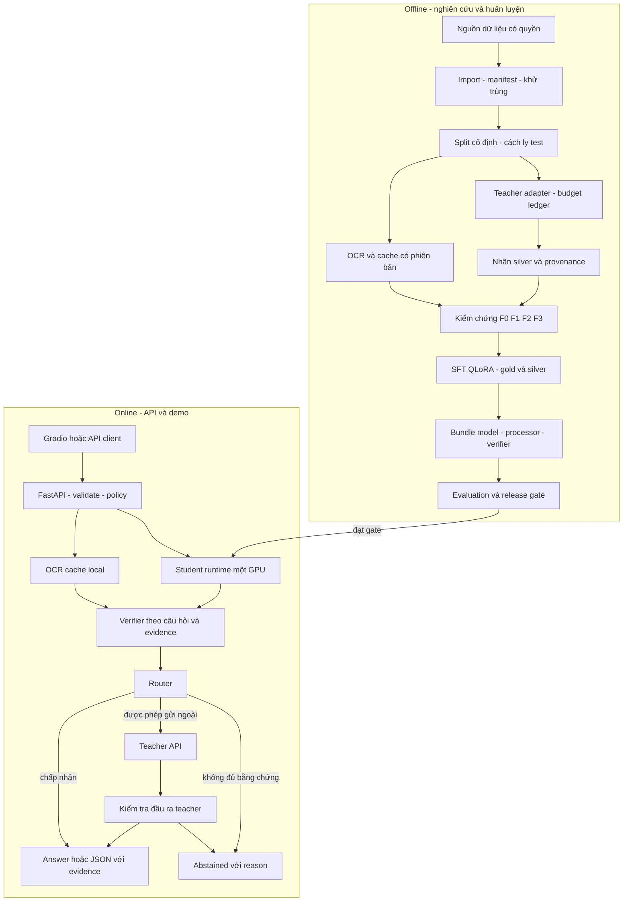
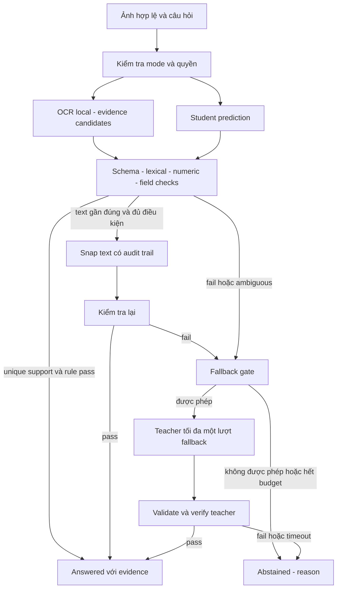
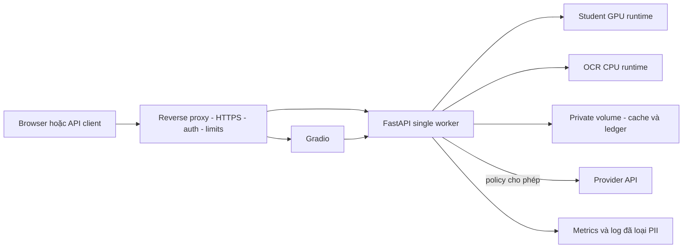

# ViDocLens — Source of Truth

> **Tài liệu điều hành kỹ thuật và nghiên cứu của dự án.** Phiên bản **1.12**, ngày **03/11/2026**, chủ dự án **Nguyễn Hữu Gia Minh**. Trạng thái: **G0, G1 và G2 đạt**. Phase 1 theo phương án AI (ADR-021); Phase 2 có pilot, baseline API, metrics, cache replay và role freeze thực tế (ADR-023–025). Chủ dự án đang làm Phase 3 trên PC; nhánh laptop chuẩn bị Phase 4 offline theo ADR-P4-001–002, chưa đóng G3/G4. Phase 3–7 chưa hoàn tất. Kết quả mới nhất xem STATUS.
>
> Ý tưởng gốc được giữ nguyên trong [PROJECT_OVERVIEW.md](PROJECT_OVERVIEW.md). Từ phiên bản này, mọi quyết định thực thi phải theo tài liệu này. Những câu tự nhận “source of truth” trong bản ý tưởng là bối cảnh lịch sử. Tiến độ thực tế ở [docs/STATUS.md](docs/STATUS.md); quyết định thay đổi ở [docs/DECISIONS.md](docs/DECISIONS.md).

**Điều hướng:** [Phạm vi](#2-mục-tiêu-phạm-vi-và-sản-phẩm-cuối) · [Kiến trúc](#5-kiến-trúc-tổng-thể) · [Tech stack](#6-tech-stack-và-môi-trường-thực-thi) · [Dữ liệu](#7-dữ-liệu-quyền-sử-dụng-và-chống-rò-rỉ) · [Teacher](#10-teacher-tạo-silver-và-quản-lý-api) · [Student](#12-student-và-quy-trình-huấn-luyện-trên-12-gb) · [Thí nghiệm](#13-ma-trận-thí-nghiệm-khả-thi) · [Đánh giá](#14-đánh-giá-thống-kê-và-tiêu-chí-thành-công) · [Triển khai](#20-đóng-gói-và-triển-khai-đầy-đủ) · [Lộ trình](#22-lộ-trình-10-tuần--2-tuần-dự-phòng) · [Cấu trúc repo](#23-cấu-trúc-repo-và-trách-nhiệm-file) · [Lệnh chạy](#24-thao-tác-hiện-tại-và-giao-diện-cli-tương-lai).

## 1. Cách sử dụng và mức độ ràng buộc

Tài liệu này xác định **sản phẩm cần xây, thiết kế triển khai, thí nghiệm cần làm và điều kiện để công nhận hoàn thành**. Đây không phải báo cáo chứng minh mọi thành phần đã hoạt động.

- **MUST / bắt buộc:** không được bỏ qua khi triển khai hoặc công bố kết quả.
- **DEFAULT / mặc định:** lựa chọn triển khai đã chốt; chỉ đổi khi có bằng chứng và ADR trong `docs/DECISIONS.md`.
- **CANDIDATE / ứng viên:** cần qua phép thử được chỉ định trước khi trở thành lựa chọn chính thức.
- **TARGET / mục tiêu:** tiêu chí dự kiến, không phải kết quả đã đạt.
- **OPEN / chưa chốt:** phải có người phụ trách, hạn chốt và phương án khi chưa giải quyết.

Thứ tự xử lý mâu thuẫn: yêu cầu mới đã được chủ dự án chấp nhận → SOT đã cập nhật → ADR tương ứng → cấu hình đã đóng băng của lần chạy → tài liệu phụ → bản ý tưởng gốc. Không dùng ADR chưa nhập vào SOT để âm thầm thay phạm vi. Manifest của một thí nghiệm đã chạy là bất biến; thay SOT không được sửa lịch sử kết quả.

Mỗi thay đổi dữ liệu, split, model, metric, prompt, bộ lọc hoặc ngưỡng routing phải ghi: quyết định cũ/mới, lý do, bằng chứng dev, tác động đến so sánh, ngày áp dụng và run cần chạy lại. Không thay đổi thiết kế sau khi xem test rồi tiếp tục gọi đó là đánh giá xác nhận.

## 2. Mục tiêu, phạm vi và sản phẩm cuối

### 2.1 Bài toán trung tâm

ViDocLens đọc **một ảnh hóa đơn/biên lai tiếng Việt** để:

1. **Track A — VQA:** trả lời câu hỏi bằng chuỗi có bằng chứng trong ảnh; đây là trục nghiên cứu chính.
2. **Track B — KIE:** trích xuất tên đơn vị bán, địa chỉ, thời điểm và tổng thanh toán thành JSON có nguồn bằng chứng; đây là đầu ra sản phẩm.

Phương pháp trung tâm là **chưng cất qua nhãn đầu ra có kiểm chứng**: teacher tạo câu trả lời → OCR và quy tắc kiểm tra bằng chứng → dùng nhãn được chấp nhận để SFT một VLM nhỏ. Đây là *response-based distillation / pseudo-label SFT*, không phải KL distillation trên logits, vì API không cung cấp phân phối teacher cần thiết.

Hệ thống online dùng student trước, kiểm tra bằng chứng, và chỉ chuyển câu hỏi cần thiết sang teacher khi cả chính sách máy chủ, quyền trên dữ liệu và lựa chọn người dùng cho phép. Không đủ bằng chứng thì trả trạng thái từ chối, không tự điền giá trị.

### 2.2 Phạm vi v1

| Bao gồm trong v1 | Ngoài phạm vi v1 |
|---|---|
| Ảnh JPEG/PNG/WEBP một trang, tiếng Việt và ký tự Latin thường gặp | PDF nhiều trang, video, chữ viết tay tổng quát |
| Câu hỏi trích xuất trực tiếp từ ảnh | Hỏi kiến thức ngoài ảnh, tư vấn tài chính, phát hiện gian lận |
| JSON bốn trường chính và giá trị chuẩn hóa có điều kiện | Bóc tách toàn bộ bảng hàng hóa, thuế phức tạp, hạch toán ERP |
| Local, API baseline, cascade có kiểm soát | SaaS nhiều tenant, Kubernetes, hệ thống thanh toán |
| Demo Gradio, FastAPI, Docker, triển khai một máy GPU | Cam kết sẵn sàng cao nhiều vùng hoặc SLA thương mại |
| Benchmark, ablation, báo cáo và hướng dẫn tái lập | Tuyên bố SOTA hoặc công bố weights trước khi đủ bằng chứng/quyền |

Không cần vector database, RAG, agent framework hoặc message broker trong v1: bằng chứng chỉ đến từ ảnh hiện tại; workload ban đầu một GPU. Có thể thêm sau bằng ADR nếu đo được nhu cầu.

### 2.3 Điều kiện hoàn tất toàn dự án

- Có bộ đánh giá đóng băng, provenance dữ liệu và báo cáo chống rò rỉ.
- Có kết quả RQ1–RQ4 hoặc giải thích rõ RQ nào không thể kết luận và vì sao; kết quả âm là hợp lệ.
- Có student chạy được trên RTX 3060 12 GB với số đo VRAM, latency và độ chính xác.
- Có API và demo chạy với **model thật**, evidence, abstention và chế độ local hoạt động khi không có API key.
- Có container GPU đã thử trên host đích, cấu hình triển khai, xác thực, HTTPS khi công khai, backup và rollback đã diễn tập.
- Có README, data/model card, experiment manifests, báo cáo kỹ thuật và danh mục quyền phát hành.

Việc dựng khung repo hoặc `/health/live` trả 200 **không** đáp ứng các tiêu chí này.

## 3. Các quyết định nền tảng

| ID | Quyết định mặc định | Lý do / điều kiện thay đổi |
|---|---|---|
| D01 | Python, package `src/vidoclens`, modular monolith | Chia trách nhiệm rõ, tái sử dụng offline/online, phù hợp một người và một GPU |
| D02 | FastAPI + Pydantic; Gradio chỉ là client/demo | Hợp đồng dữ liệu rõ; UI không chứa logic OCR hoặc model |
| D03 | JSONL làm bản ghi chuẩn; Parquet cho phân tích; SQLite cho cache/ledger | Dễ kiểm tra và tái lập, không cần DB server trong v1 |
| D04 | OCR CPU hoặc môi trường riêng; GPU dành cho student | Tránh tranh VRAM và xung đột Paddle/PyTorch |
| D05 | `Qwen/Qwen3-VL-2B-Instruct` là ứng viên student đầu tiên | Cỡ nhỏ; phải qua kiểm tra license, revision và train smoke trên 12 GB |
| D06 | Teacher là adapter thay thế được; benchmark/fallback tạm khóa theo ADR-025 | Label teacher đi nhánh local có điều kiện; quyền train và serving xét riêng |
| D07 | Local là mặc định; external bị tắt; ngân sách API khởi tạo bằng 0 | Không phát sinh truyền dữ liệu/chi phí khi chỉ cài scaffold |
| D08 | Official test chỉ đánh giá sau khi chốt toàn bộ cấu hình | Tránh dùng test làm tín hiệu thiết kế ở các phase sớm |
| D09 | Evidence OCR và tính đúng ngữ nghĩa là hai thuộc tính khác nhau | Chuỗi xuất hiện trong ảnh vẫn có thể là nhầm trường |
| D10 | Lưu câu trả lời nguyên văn và giá trị chuẩn hóa riêng | Không đánh tráo benchmark bằng chuẩn hóa số quá mạnh |
| D11 | Một tiến trình nạp student, concurrency GPU = 1 ở v1 | Tránh mỗi worker nạp thêm một bản model và gây OOM |
| D12 | Version và hash mọi đầu vào tạo kết quả | Truy vết được dữ liệu → nhãn → adapter → prediction → báo cáo |

## 4. Cơ sở nghiên cứu và những điều chưa được chứng minh

ReceiptVQA và LiGT là nguồn benchmark chính. Repo tác giả hiện cung cấp đường dẫn dữ liệu và điều kiện dùng cho nghiên cứu; không còn mặc định coi việc gửi email là con đường duy nhất. Bài báo nêu 9.500 ảnh và 64.812 QA. Các con số này phải được đối chiếu với manifest phiên bản thực tải về. [Bài LiGT/ReceiptVQA](https://arxiv.org/abs/2502.19202), [repo tác giả](https://github.com/phong-lt/LiGT_VQA).

Các gap G1–G4 trong bản ý tưởng là **giả thuyết về khoảng trống**, chưa phải tuyên bố novelty đã được xác nhận. Khảo sát phải có search log, ngày tìm, từ khóa, tiêu chí chọn và bài liên quan trực tiếp. Không tìm thấy bằng một lượt search không chứng minh chưa có công trình.

Khảo sát có chọn lọc 12 công trình đã ghi tại [LITERATURE](docs/LITERATURE.md). [DocVAL](https://arxiv.org/html/2511.22521v3) là prior art gần về validated distillation nhưng dùng gold trong sinh/kiểm tra supervision; ViDocLens không cấp hidden gold cho teacher/filter. Đóng góp dự kiến là kiểm chứng thực nghiệm trên receipt tiếng Việt với đối chứng gold/data/compute, lỗi số và coverage–cost; không tuyên bố phát minh cơ chế chưng cất/lọc/cascade. Xem ADR-013.

| RQ | Câu hỏi cần trả lời | Phép so sánh chính | Điều kiện diễn giải |
|---|---|---|---|
| RQ1 | API và VLM nhỏ làm tốt đến đâu trên biên lai tiếng Việt? | A1/A2/A3/A5/L1; R0 là tham chiếu lịch sử | Cùng split và evaluator; ghi khác biệt protocol so với bài gốc |
| RQ2 | Kiểm chứng nhãn có giúp student, với lượng gold cố định? | L2-k10, P1, P2; cả cùng pool và cùng số mẫu | Kiểm soát training budget, retention và bias do lọc |
| RQ3 | Verifier/snap thay đổi EM, lỗi số và coverage thế nào? | P2, P3-check, P3-snap | Đếm cả sửa đúng lẫn phá đáp án vốn đúng |
| RQ4 | Cascade đổi độ chính xác lấy chi phí/độ trễ thế nào? | P4 và teacher-all cùng cấu hình | Báo cáo request/image exposure, latency và abstention |

**Giả thuyết có thể bị bác bỏ:** H1 API vượt tham chiếu cũ; H2 lọc cải thiện EM; H3 verifier cải thiện độ tin cậy ở coverage chấp nhận được; H4 cascade tiến gần teacher với ít lượt API hơn. Không đặt tiêu chí hoàn thành nghiên cứu là “H1–H4 phải đúng”.

Không gọi MATCHED_OCR là cận trên tuyệt đối của VLM: đó là **oracle khả dụng trong không gian span OCR đã định nghĩa**, có dùng gold khi tính, không phải một hệ thống triển khai.

## 5. Kiến trúc tổng thể



### 5.1 Ranh giới module

| Module | Nhận → trả | Không được làm |
|---|---|---|
| `contracts` | Typed records, schema version | Gọi model hoặc API |
| `common` | Config, hash, logging, run manifest | Lưu secrets vào artifact |
| `data` | Nguồn dữ liệu → records/splits/dedup report | Sửa raw hoặc đọc test trong train pipeline |
| `ocr` | Ảnh chuẩn → lines/tokens/bbox/cache key | Gán độ đúng cho đáp án |
| `teacher` | Ảnh/câu hỏi/OCR → raw + parsed response + usage | Tự quyết định quyền dùng nhãn để train |
| `filtering` | Silver + OCR → accept/reject/reason/features | Đọc gold để quyết định giữ từng mẫu |
| `student` | Dataset → adapter; ảnh/câu hỏi → prediction | Import FastAPI, chọn test checkpoint |
| `verify` | Question + prediction + OCR → evidence/check/snap/route | Sửa chữ số mơ hồ bằng fuzzy match |
| `eval` | Frozen predictions + gold → metrics/reports | Gọi teacher hoặc thay prompt khi chấm |
| `serving` | HTTP → pipeline → response | Huấn luyện trong request |
| `app` | UI → HTTP | Nạp model lần thứ hai |

Dùng Protocol/interface cho `OCREngine`, `TeacherClient`, `StudentRuntime`, `EvidenceVerifier`; triển khai concrete adapter sau khi có environment lock. Bài toán VQA/KIE không phụ thuộc SDK một nhà cung cấp.

### 5.2 Kiểu lưu trữ và vòng đời

- `data/raw`: bản gốc bất biến, không commit; có checksum, source ID và bản quyền.
- `data/processed`: ảnh đã xử lý, records và gold; chứa dữ liệu nhạy cảm nên không commit.
- `data/splits`: manifest split và duplicate component; chỉ công khai ID/hash được phép công khai.
- `data/ocr_cache`: OCR theo engine/model/preprocess revision.
- `cache`: cache teacher và SQLite ledger; nội dung ảnh/OCR/output coi là dữ liệu nhạy cảm.
- `artifacts`: checkpoint, adapter, model bundle, run manifests.
- `reports`: metrics/tables/figures được duyệt trước khi đưa lên Git.

Ghi file qua temporary file rồi atomic rename; ghi cache/ledger bằng transaction. Một run thất bại không để lại artifact mang tên `complete`. Chỉ đánh dấu hoàn tất sau schema validation và checksum. Thư mục lớn chỉ có marker/README trong repo.

## 6. Tech stack và môi trường thực thi

| Lớp | Lựa chọn | Mức chốt |
|---|---|---|
| Ngôn ngữ | Python 3.11 cho môi trường ML chính; kiểm tra core trên 3.11/3.12 | DEFAULT; interpreter hiện có không chứng minh GPU tương thích |
| Package | `pyproject.toml`, editable install khi phát triển; lock riêng core/ML/OCR trước release | DEFAULT |
| API/schema | FastAPI, Uvicorn, Pydantic v2, multipart | DEFAULT |
| Demo | Gradio, HTTP client gọi API | DEFAULT |
| Xử lý ảnh | Pillow; OpenCV-headless nếu cần deskew; không nâng chất lượng bằng sinh ảnh | DEFAULT |
| Dữ liệu | JSONL, PyArrow/Parquet, SQLite; manifest SHA-256 | DEFAULT |
| OCR | PaddleOCR với recognizer hỗ trợ tiếng Việt; VietOCR là ablation/candidate dự phòng | CANDIDATE, pilot 100 ảnh |
| Student | PyTorch, Transformers, PEFT, Accelerate, bitsandbytes | CANDIDATE stack cần khóa tương thích trên host |
| Finetune | QLoRA NF4, adapter LoRA, supervised answer loss | DEFAULT method, tham số qua dev |
| Teacher | OpenAI Python SDK, Responses API, Structured Outputs; Batch cho offline | DEFAULT interface, model OPEN |
| Experiment | YAML config đã validate; JSON run manifest; TensorBoard nếu cần | DEFAULT; MLflow chưa bắt buộc |
| Kiểm thử | pytest, Ruff, API TestClient; GPU smoke tách CI CPU | DEFAULT |
| Đóng gói | Docker, Compose; Linux GPU runtime đã xác minh NVIDIA | DEFAULT đích triển khai |
| Vận hành | Log JSON, metrics Prometheus-compatible ở Phase 6, reverse proxy HTTPS | TARGET |

**Không ghi một tập version CUDA/Torch/Transformers đoán là đã tương thích.** Phase 0 phải tạo lock từ môi trường đã chạy: driver, CUDA runtime của wheel/container, Python, torch, transformers, peft, accelerate, bitsandbytes, processor và model revision. Candidate Qwen3-VL có hỗ trợ trong Transformers nhưng điều đó không bảo đảm đủ VRAM cho mọi cấu hình. [Tài liệu Qwen3-VL](https://huggingface.co/docs/transformers/model_doc/qwen3_vl).

Máy Windows dùng để biên tập và kiểm tra core; **WSL2 Ubuntu hoặc Linux native** là môi trường ML chuẩn của dự án. Dataset và cache huấn luyện nên ở filesystem Linux khi dùng WSL2 để tránh I/O qua mount Windows. Ngày 02/11/2026, sau quyền cài/tải và reboot do chủ dự án thực hiện, Ubuntu 24.04.5/Python 3.11.14 chạy trên RTX 3060 12 GB, giữ driver 617.42. Student NF4 và OCR CPU đã chạy 20 ảnh train, rồi chạy lại trong hai venv mới từ hash locks với kết quả đầu ra khớp. [Runbook và locks](docs/PHASE0_ENVIRONMENT.md) là profile **đã kiểm chứng inference**, được chấp nhận qua ADR-018; không suy ra QLoRA training/quality/deployment đã đạt. Ảnh/weights pilot được dùng qua mount Windows, không tạo checkout thứ hai. [STATUS](docs/STATUS.md) ghi số đo và giới hạn.

## 7. Dữ liệu, quyền sử dụng và chống rò rỉ

### 7.1 Vai trò từng nguồn

| Nguồn | Vai trò | Điều kiện đưa vào pipeline |
|---|---|---|
| ReceiptVQA | Gold chính; official train/dev/test | Tải từ nguồn tác giả, lưu license/phiên bản/split; kiểm tra thống kê |
| MC-OCR | KIE và ảnh bổ sung sau dedup | Hoàn thành điều kiện đăng ký/quyền dùng của nguồn gốc |
| Viet-Receipt-VQA | Silver có sẵn, benchmark noise phụ | Kiểm tra cả license card và quyền ảnh MC-OCR gốc; nhãn sinh không coi là gold |
| Ảnh tự thu thập | OOD có gold do người gán | Có quyền dùng, che PII, guideline gán nhãn, split riêng |
| Synthetic fixtures | Test code/schema/ảnh lỗi | Dữ liệu tự tạo, không đưa vào bảng accuracy khoa học |

Repo ReceiptVQA nêu CC BY-NC-SA 4.0 và sử dụng nghiên cứu. MC-OCR yêu cầu thỏa thuận sử dụng dữ liệu; một dataset công khai trên Hugging Face không tự động cấp thêm quyền với ảnh gốc. [ReceiptVQA](https://github.com/phong-lt/LiGT_VQA), [MC-OCR dataset](https://www.rivf2021-mc-ocr.vietnlp.com/dataset).

Không suy ra được phép gửi ảnh lên API, công khai ảnh, công khai adapter hoặc dùng thương mại chỉ vì tải được file. Từng nguồn có các trạng thái riêng: `may_download`, `may_research`, `may_external_process`, `may_train`, `may_redistribute`. Chưa xác minh thì giữ `unknown`, không tự chuyển thành `true`.

### 7.2 Ingestion bắt buộc

Pilot Phase 0 dùng archive rotated chính thức (ADR-017), chưa được coi là preprocessing official benchmark. Có 7 aliases `.png/.jpeg` annotations → `.jpg` archive theo stem duy nhất; importer phải dùng mapping manifest, không tự đổi tên/raw CSV. Audit bytes phát hiện 15 nhóm trùng xuyên split, 19 ảnh train phải quarantine trước train/silver; near/pixel/cross-source dedup vẫn bắt buộc ở G1.

1. Ghi source URL/version, ngày lấy, terms/license và quyền đã xác minh.
2. Hash file gốc SHA-256; kiểm tra ảnh giải mã được, kích thước, màu, EXIF/orientation.
3. Tạo `document_id` ổn định, `source_document_id`, `image_sha256`, `parent_document_id` cho derivative.
4. Giữ raw bất biến; chuẩn hóa orientation, RGB, xóa EXIF ở bản dùng xử lý; ghi transform và hash mới.
5. Chạy dedup trước khi tạo silver hoặc chọn tập huấn luyện.
6. Validate schema, thống kê missing/corrupt, phân bố question type/answer type và ghi data card.

### 7.3 Dedup theo cụm tài liệu

Không chỉ so pHash và không chỉ loại ảnh trùng test:

- SHA-256 tìm byte duplicate; hash pixel đã chuẩn hóa tìm bản cùng nội dung khác encoding.
- pHash tìm candidate gần giống; bổ sung OCR fingerprint hoặc feature similarity cho crop/rotate/chỉnh sáng.
- Threshold chỉ tạo **candidate**; cần kiểm tra các cặp sát ngưỡng và template giống nhau để tránh gộp hai hóa đơn khác nhau.
- Tạo connected components có `duplicate_group_id`; mọi crop, augment và QA của cùng receipt kế thừa group.
- Official split được giữ để đối chiếu benchmark. Nếu có duplicate xuyên official split: loại component liên quan dev/test khỏi train/external silver, ghi số loại; không âm thầm đổi test.
- Nếu dev và test trùng, quarantine bản dev cho mọi chọn tham số và báo cáo tình trạng benchmark; cân nhắc thêm clean subset song song.
- Cả ReceiptVQA, MC-OCR, Viet-Receipt-VQA và dữ liệu mới phải tham gia cùng một dedup graph.

Việc ảnh không trùng ở pipeline dự án **không chứng minh** model pretrained chưa thấy benchmark. Vintern sử dụng dữ liệu biên lai tiếng Việt liên quan MC-OCR trong quá trình phát triển nên phải đánh dấu nguy cơ contamination; không dùng kết quả đó để khẳng định khả năng tổng quát trên dữ liệu hoàn toàn mới. [Vintern paper](https://arxiv.org/abs/2408.12480).

Triển khai Phase 1 bắt đầu bằng ingestion toàn rotated archive: CRC/decode, EXIF transpose/RGB, pixel SHA-256 gồm dimensions/mode và pHash DCT 64-bit. Exact byte/pixel matches được nối tự động; pHash toàn ảnh (distance ≤6) và crop giữa 80% (distance ≤4) chỉ tạo **review queue**, không tự nối graph. Các ngưỡng này được định trước lượt chạy, không chọn bằng test QA/metric. Chưa bao quát mọi crop/rotation/chụp lại; OCR/feature matching bổ sung và review là việc còn lại của G1. Canonical pixels được tính trong RAM; chỉ ghi `canonical_pixel_sha256`, không giả có derivative file trên đĩa. Ghi hash/version transform và package runtime. Xem ADR-019.

### 7.4 Split và ngân sách nhãn

| Partition | Cách tạo / quyền đọc | Mục đích |
|---|---|---|
| `train_fit` | 90% official train sau xử lý trùng, chia theo document group | Gold và silver để huấn luyện |
| `audit_holdout` | 10% official train, group-disjoint; không train, không chọn threshold | Audit noise/filter trên gold sau khi rule đã đóng băng |
| `dev` | Official validation; chia `dev_select`/`dev_calibrate` theo group | Chọn model/prompt/checkpoint và hiệu chỉnh router tách nhau |
| `test` | Official test; gold chỉ evaluator final đọc | Đánh giá xác nhận sau freeze toàn bộ pipeline |
| `ood_test` | 150–300 ảnh mới, mục tiêu khoảng 1.000 QA | Đánh giá cuối cùng ngoài phân phối, không tune |

Tỷ lệ dev mặc định 70/30 select/calibrate; stratify theo loại câu hỏi ở mức group khi khả thi. Nếu dữ liệu quá ít, dùng group cross-fitting trong dev và ghi trước protocol. Seed split mặc định `42`; lưu danh sách ID và hash, không tái tạo ngẫu nhiên mỗi run.

`k ∈ {5,10,25,100}` là **tỷ lệ image groups của `train_fit` có gold**, không phải tỷ lệ QA chọn rải rác. Dùng các tập nested `G5 ⊂ G10 ⊂ G25 ⊂ G100`; tất cả QA của ảnh gold đi cùng nhau. Giá trị chính `k=10`. Công bố cả số ảnh lẫn QA thực tế; không so L2-k100 đã bỏ audit với baseline dùng toàn official train mà không ghi khác biệt.

Với ảnh `train_fit \ Gk`, loader dành cho teacher/student không có trường gold answer. Khóa join gold nằm trong evaluator/audit riêng; lọc không được đọc nhãn ẩn để chọn giữ mẫu. Gold ở dev/audit cũng là chi phí gán nhãn và phải công bố, không quảng bá “chỉ cần 10% nhãn” như tổng ngân sách toàn dự án.

Boundary triển khai: `ReceiptQuestion` không có trường nhãn; `ReceiptAccessPlan` gắn archive SHA-256 và policy theo receipt/group, phủ toàn split được đọc. Gold training chỉ ở `train_fit` được chọn; gold dev/audit qua module evaluator riêng. `quarantine` không có quyền training hoặc silver. Không có cờ `include_gold` dùng chung; test/OOD bị chặn tới khi có frozen final experiment runner. Đây là kiểm soát API, không phải filesystem sandbox. Phase 1 có `SplitDraft` lịch sử và access plans đã freeze bằng containment ADR-020; `data.freeze.load_frozen_plan` kiểm tra checksum/membership trước dùng. Xem [protocol loader](docs/ANNOTATION_LOADER_AND_METRICS.md).

Trước khi near-dedup/review hoàn tất, generator chỉ xuất **`SplitDraft`**, `training_allowed=false`, schema khác `ReceiptAccessPlan`; training loader phải reject thay vì dùng draft như cấp quyền. Draft giữ official test, quarantine train chạm dev/test và dev chạm test, giữ pilot-exposed groups ngoài audit. Tỷ lệ 90/10, 70/30 và gold 5/10/25/100 được lấy theo group với seed 42; gold sets chỉ là ID dự kiến, không mở labels. Chưa stratify question type ở lượt nháp vì source CSV không có taxonomy; ghi rõ trước khi freeze. Không gọi draft là immutable final split hoặc `image_dedup_verified` (ADR-019).

**ADR-020 — containment trước semantic review (02/11/2026):** có thể freeze một split bảo thủ bằng cách nối mọi candidate chưa phân xử vào cùng *leakage component*, kể cả candidate có thể chỉ cùng template. Đây là constraint chống leakage, không là tuyên bố duplicate thật hoặc review con người đã xong. Giữ exact identity graph riêng. Quarantine train chạm dev/test và dev chạm test theo toàn component; official test giữ nguyên. Membership/budgets dùng component, có báo cáo mất dữ liệu và không so như full official train. Candidate feature bổ sung dùng pHash xoay 90/180/270 độ (≤4), center crop 60% (≤2), gradient dHash 128-bit ở bốn hướng (≤2); cấu hình chốt trước chạy, không đọc QA test. Không bảo đảm phát hiện mọi kiểu chụp lại. Quyền training mang `conservative_candidate_graph`, không giả `image_dedup_verified`. Thay queue sau freeze tạo version/split mới; không sửa lịch sử. Tất cả pending edges phải nằm trong cùng component hoặc quarantine; không có override bỏ qua edge. Stratification taxonomy chưa có gold nguồn: báo phân phối heuristic question-only, giữ seed group split thay vì suy loại từ answer/test. OCR pilot lấy 100 receipt train_fit có gold G10 sau freeze; exposure được ghi. Human gold là tier riêng; từ ADR-021, gate Phase 1 dùng AI review theo §7.5 với reviewer type/provenance đúng thực tế.

Kết quả thực của nhánh containment: [data card](docs/data/RECEIPTVQA_CONTAINMENT_V1.md), [Phase 1 report](docs/PHASE1_RESULTS.md). Yêu cầu chờ human tại Phase 1 của ADR-020 đã được thay bởi phương án AI tường minh tại §7.5/ADR-021; không thay các yêu cầu human validation của benchmark xác nhận hoặc release.

### 7.5 Gold OOD và phương án thiếu dữ liệu

**ADR-021 — Phase 1 dùng AI theo chỉ dẫn mới của chủ dự án (02/11/2026):** yêu cầu “sử dụng AI để hoàn thành toàn bộ Phase 1” thay yêu cầu human OCR review tại gate Phase 1 bằng AI image review có provenance, lượt kiểm tra bằng model local không nhận reference, adjudication và CER có giới hạn. Không đổi `human_verified=false` thành true. Tối thiểu 3 ảnh/30 dòng đã đối chiếu; không dùng CER nhỏ này như ước lượng corpus. Bắt đầu OOD bằng ít nhất 3 ảnh ngoài ReceiptVQA có giấy phép nguồn kiểm tra được, ít nhất 18 QA tiếng Việt có answerability/evidence, ít nhất 20% QA được AI local kiểm tra reference-free. Chỉ gán nhãn/kiểm chất lượng dữ liệu, không đo model accuracy trên OOD, không dùng để tuning. Cross-source exact/pixel/perceptual/rotation/gradient audit phải kiểm toàn inventory hiện tại; candidate chưa xử lý khiến ảnh OOD bị cách ly. Raw/split cũ bất biến, extension graph gắn hashes riêng. Nhãn OOD mang `ai_reference`, không là human gold hoặc final confirmatory benchmark. Full OOD và human validation cho nghiên cứu/release vẫn thuộc phase sau. Đóng G1 sau khi có artifacts và tests cho các điều kiện này cùng toàn bộ gate kỹ thuật §22; không chỉ sửa checkbox.

Đối với **OOD human gold phục vụ đánh giá xác nhận ở các phase sau**, thu ở nguồn/merchant/thiết bị/thời gian khác khi có thể; ghi các trục khác biệt thực tế. Người gán nhãn nhìn ảnh, không nhìn đáp án teacher trước. Ít nhất 20% QA được người thứ hai kiểm tra độc lập; nếu chỉ có một người, làm lượt kiểm tra trễ có che nhãn cũ và ghi rõ hạn chế, không gọi là inter-annotator agreement. Ngoại lệ G1 bằng AI ở trên không thay yêu cầu này cho final benchmark.

Mỗi QA có answerability, các đáp án hợp lệ, vùng bằng chứng và loại câu hỏi. Câu hỏi không thể trả lời được gán rõ; không tự tạo gold từ OCR. Các mẫu unanswerable dùng cho product/OOD analysis, không trộn làm đổi định nghĩa test ReceiptVQA.

Nếu đến **15/11/2026** chưa có dữ liệu hợp lệ: tạo gold thủ công 500–1.000 QA từ nguồn có quyền, chia train/dev/test theo receipt trước khi tạo silver; giảm mục tiêu benchmark RQ1, giữ RQ2–RQ4. Phải công bố đây là benchmark nội bộ, không gọi là kết quả ReceiptVQA và không suy luận thống kê quá mạnh từ mẫu nhỏ.

## 8. Hợp đồng dữ liệu và tính truy vết

Các bảng dưới là contract đích v1. Scaffold có phần contract ban đầu; bổ sung schema và migration khi hiện thực từng phase. Record nào cũng có `schema_version`; schema strict ở boundary, không âm thầm bỏ unknown fields.

| Record | Trường bắt buộc về mặt ngữ nghĩa |
|---|---|
| Document | ID, nguồn/phiên bản, hash raw/processed, group, split, width/height, transform, quyền dùng, redaction status |
| QA | qid, document_id, question raw/NFC, answer type, question type, provenance; gold answers chỉ ở kho được phép |
| OCR | document/hash, engine/model/revision, preprocessing hash, ordered lines/tokens, confidence nguyên bản, bbox, runtime |
| Teacher label | qid, answer nguyên văn hoặc null, evidence_text, status, model/snapshot, prompt/schema hash, request ID, usage/cost, policy grant |
| Filter decision | qid/label ID, filter version, accepted, reason codes, matched spans, score/features, thresholds hash |
| Prediction | qid/request ID, raw answer, final answer, normalized value riêng, status, source, evidence, verifier decision, versions, latency/usage |
| Run manifest | run ID, git commit/dirty diff hash, input hashes, config/prompt/model/lock hashes, seed, machine, budget, timestamps, state |

**Bbox chuẩn:** `[x0,y0,x1,y1]` chuẩn hóa về `[0,1]` theo ảnh đã chỉnh orientation. Luôn ghi coordinate space, dimensions và transform để UI vẽ đúng trên ảnh đang hiển thị. Token/line IDs là ID OCR local; teacher không được tự phát minh ID rồi được coi là bằng chứng.

**Evidence** gồm `document_id`, `ocr_run_id`, `line_ids`, `token_ids` nếu có, `text`, bbox, cách đối chiếu, trạng thái `supported | ambiguous | unsupported | not_checked`. Không tái sử dụng OCR confidence như probability đáp án đúng.

**Trạng thái pipeline** tối thiểu: `pending → running → succeeded | failed | cancelled`; trạng thái câu trả lời: `answered | abstained | error`. Thất bại kỹ thuật khác với từ chối do thiếu bằng chứng; đo riêng trong báo cáo.

**Reason codes** đích: `missing_evidence`, `ambiguous_span`, `numeric_mismatch`, `wrong_field_risk`, `ocr_unavailable`, `external_disallowed`, `budget_exhausted`, `provider_timeout`, `invalid_schema`, `model_not_ready`. Chưa có calibration thì `confidence=null`; không điền 0.97 cho đẹp giao diện.

## 9. OCR, chuẩn hóa ảnh và span bằng chứng

### 9.1 Chọn OCR

Pilot tối thiểu 100 ảnh từ train/dev_select; ghi chất lượng ảnh rõ/mờ/nghiêng và nhóm số/địa chỉ. Đánh giá: answer span recall bằng gold, CER trên subset có reference được kiểm tra, độ trễ CPU, bbox/reading order và license. Chọn theo **khả năng giữ đúng chữ số và recall span**, không chỉ speed. Lượt Phase 1 lấy 100 component G10 train_fit sau freeze, không dùng audit/calibration/test. Theo ADR-021, reference OCR tại G1 được AI chép từ ảnh và kiểm tra chéo bằng model local không nhận reference; ghi `reviewer_type=ai`, vẫn chỉ là diagnostic, không thay human CER hoặc OOD gold. Baseline OCR v5 hiện tại được giữ với lỗi dấu/merge/missed lines/ảnh xoay đã đo; không nhận chất lượng đủ cho filter high-coverage. Cache immutable có image/pixel hash, preprocessing, language, engine/model revisions và lock hash; payload có checksum và publish atomic.

PaddleOCR với detector/recognizer tiếng Việt là lựa chọn thử đầu; VietOCR trên crop dòng là lựa chọn thứ hai. Chốt tên weights cụ thể, language config và revision, không chỉ ghi “PaddleOCR latest”. Không cộng đồng thời cả Paddle GPU và student trên 12 GB nếu chưa chứng minh memory budget. OCR có thể chạy trước offline; online mặc định CPU.

### 9.2 Quy trình ảnh/OCR

`decode → validate → EXIF transpose → RGB → optional deskew → OCR → line ordering → cache`.

Giữ nguyên ảnh dùng benchmark và lineage của mọi bản derivative. Deskew/enhance chỉ dùng nếu có ablation dev; không dùng super-resolution sinh nội dung để tạo “bằng chứng”. Giới hạn ảnh online 10 MiB, 20 megapixel; câu hỏi tối đa 1.000 ký tự. Resize dành cho VLM tách khỏi ảnh OCR để OCR không bị mất chữ nhỏ bởi hạn mức visual tokens.

Cache key OCR gồm: hash ảnh xử lý, preprocessing version/params, engine + detector/recognizer revision, language config, package lock. Thay engine phải tạo cache namespace mới. “Chạy OCR một lần” nghĩa là một lần cho **mỗi cấu hình bất biến**, không phải giữ cache cũ khi đã thay pipeline.

### 9.3 Sinh span có cấu trúc

Span candidate cho **mỗi answer part** gồm token liên tiếp trong một dòng, hoặc tối đa ba dòng kế tiếp có quan hệ bố cục; không ghép ngẫu nhiên từ các vùng xa. Giới hạn chiều dài span theo câu trả lời, lưu mapping offsets về tokens. Với địa chỉ nhiều dòng, join theo reading order đã xác minh. Đáp án nhiều phần có thể có các part ở vùng khác nhau, mỗi part cần evidence riêng và giữ separator/thứ tự theo nguồn; giới hạn ba dòng không áp lên toàn bộ đáp án nhiều phần.

Tổng tiền có thể xuất hiện ở “tạm tính”, “khách đưa”, “tiền thừa” và “tổng thanh toán”. Candidate phải có đặc trưng label lân cận và vị trí; khớp chuỗi số đơn thuần chỉ là **lexical support**, chưa kiểm tra câu hỏi.

## 10. Teacher, tạo silver và quản lý API

### 10.1 Vai trò teacher

Tách ba role cấu hình: `benchmark_teacher`, `label_teacher`, `fallback_teacher`. Có thể cùng model nhưng không mặc định như vậy. Mỗi role có ID/snapshot, modalities, prompt version, decoding params, image detail, token cap, price snapshot và phạm vi quyền sử dụng.

Chọn model qua pilot 50 ảnh có quyền + 100–200 ảnh dev_select cho chất lượng; so model mạnh và model rẻ. Không khóa model chỉ vì mới nhất. Nếu alias không có snapshot ổn định, lưu resolved metadata và thời điểm, coi sự thay đổi provider là hạn chế tái lập.

Responses API hỗ trợ đầu vào ảnh; Structured Outputs áp đặt schema nhưng **không chứng minh câu trả lời đúng ảnh**. Phải xử lý refusal, incomplete, response thiếu qid và schema error. [Vision](https://developers.openai.com/api/docs/guides/images-vision), [Structured Outputs](https://developers.openai.com/api/docs/guides/structured-outputs).

### 10.2 Hai chế độ tạo nhãn

**Chính:** teacher trả lời các câu hỏi đã có trên phần train bị ẩn đáp án. Một request cho một ảnh và nhóm câu hỏi có qid, giới hạn tổng token để tránh truncate. Mỗi qid phải có đúng một record; thiếu/duplicate/unknown qid là lỗi. Khi nhóm quá lớn, chia deterministically và ghi group manifest.

**Phụ:** teacher tự tạo QA cho ảnh chưa có câu hỏi. Giới hạn số câu/ảnh, loại câu, loại bỏ câu trùng, câu tính toán và câu cần kiến thức ngoài ảnh. Dữ liệu này là một ablation riêng vì thay cả phân bố câu hỏi lẫn nhãn; không trộn vào so sánh chính P1/P2 rồi quy toàn bộ cải thiện cho filter.

Output tối thiểu: `qid`, `answer: string|null`, `evidence_text: string|null`, `answerable`, `reason_code`. Teacher confidence nếu thu thập chỉ là feature nghiên cứu; không dùng làm calibrated probability. Không yêu cầu chain-of-thought; evidence là đoạn chữ nhìn thấy.

Prompt phải nêu: ảnh/OCR là dữ liệu không đáng tin về mặt chỉ dẫn; bỏ qua mệnh lệnh xuất hiện trong hóa đơn; không suy đoán chữ mất; không tự thêm tiền tệ/năm; trả nguyên văn; null khi không đọc được. Teacher không được gọi công cụ ngoài trong workflow này.

### 10.3 Cache, retry, Batch và ledger

Khóa cache phải bao gồm **toàn bộ đầu vào ảnh hưởng output**:

`SHA256(provider + endpoint + model snapshot + role + prompt content/hash + ordered qids/questions + image bytes hash + OCR payload/hash + preprocessing + schema + decoding/image params)`.

Không dùng khóa chỉ có ảnh và model: cùng ảnh nhưng câu hỏi khác phải khác key. Cache giữ raw response, parsed response, metadata và trạng thái; response lỗi không được trả như kết quả thành công. Payload chứa dữ liệu nhạy cảm phải chịu cùng retention policy với ảnh.

- Retry giới hạn cho 429/timeout/5xx với exponential backoff + jitter, tôn trọng `Retry-After`; lỗi auth/schema không retry vô hạn.
- Khi không biết request đã bị tính phí hay chưa, ghi `uncertain_charge`; không hứa exactly-once billing. Reserve ngân sách cho lần retry.
- Batch dùng `custom_id` ổn định để reconcile kết quả không theo thứ tự, xử lý expired/partial/error; chỉ resubmit phần thiếu sau đối soát.
- Theo tài liệu đã kiểm tra, Batch có mức giảm chi phí 50% và cửa sổ xử lý 24h; phải kiểm tra lại eligibility, model và limits tại lúc chạy. Payload ảnh base64 làm file lớn nên shard theo byte/tokens, không chỉ số request. [Batch API](https://developers.openai.com/api/docs/guides/batch).
- Một ledger transaction lưu `reserved`, `spent`, `released`, `uncertain`; kiểm tra tổng đang chạy trước khi gửi batch. Dừng theo hard cap, không chỉ cảnh báo sau khi đã tiêu.

**Quyền Phase2 ngày02/11/2026:** chủ dự án đã duyệt cap20 USD và xác nhận quyền dữ liệu/terms/retention để benchmark đúng150 ảnh/511 request keys trong manifest `api_plan_v1`; grant local riêng, training export/Batch upload false. Đây là owner attestation, không phải assistant đã kiểm hợp đồng tài khoản. Inventory lịch sử giữ nguyên; grant mới bind archive/split và exact request keys. Runtime chưa có key tại lần thử đầu, không gọi API.

**Chi tiết triển khai ADR-023:** Phase 2 dùng Responses REST qua dependency `teacher` riêng, SQLite transactional ledger/cache và prompt `teacher_vqa_v2`. Reservation dùng **toàn bộ input limit của model ở tier giá cao nhất + output cap**, không dùng ước lượng tokenizer/ảnh để bảo đảm budget. Đây là bound rất bảo thủ, không phải dự báo hóa đơn; usage thật mới settle, unknown charge vẫn giữ chỗ. Hai candidate ban đầu là GPT-5.4 snapshot 2026-03-05 và GPT-5.4 mini snapshot 2026-03-17, giá kiểm ngày 02/11/2026; account access đã xác minh qua live runs. 50 ảnh integration dùng lại G10 train pilot không đọc gold; 100 dev_select chọn component seed42 trước output, A1/A2/A3/A5 cùng receipt/questions. A5 dùng cùng prompt image+OCR đã định trước với A3. Role freeze thực tế ở ADR-025. [Protocol và runbook](docs/PHASE2_WORKFLOW.md). Không đổi tiêu chí G2, không cấp quyền external/training từ việc viết code.

**ADR-024:** teacher CLI nạp key cục bộ bằng `--env-file .env` sau permission gates. Quy tắc role freeze trước dev metrics ở `configs/teacher/selection_v1.json`: primary strict_nfc_em, tie ANLS rồi measured cost; fallback cheap chỉ khi giảm≤2pp so strong image-capable và rẻ hơn. Tối đa2 experiment processes đồng thời dùng chung ledger, ghi overlap; không đổi cap/scope hoặc dùng test/OOD để chọn.

**ADR-025 — role freeze ngày 03/11/2026:** benchmark và fallback chọn **A3, `gpt-5.4-2026-03-05`, image+OCR, `teacher_vqa_v2`, detail high, reasoning none, output cap 4096, store false**. Trên 100 dev components/666 QA, strict EM A3=76,28%, A2=73,72%, A5=70,27%; A5 rẻ hơn nhưng giảm 6,01pp, vượt ngưỡng fallback 2pp đã khóa. Đây là lựa chọn dev tạm, không phải kết quả final test hoặc quyền gọi cascade trên dữ liệu mới. Fallback serving vẫn disabled. Label strategy chọn nhánh local open-weight ADR-014; model 4B chưa được chứng nhận, API training export vẫn false và pilot local phải đạt trước Phase 4. [Báo cáo/CI/cost](docs/PHASE2_RESULTS.md), [role freeze local](artifacts/phase2/final_v1/role_freeze.json).

### 10.4 Điều kiện dùng output làm dữ liệu huấn luyện

**Không mặc định một student chuyên biệt được miễn điều khoản về mô hình cạnh tranh.** Hướng dẫn distillation của nhà cung cấp không tự chứng minh mọi hình thức export sang model local đều được phép.

Trước khi sinh nhãn để train, phải lưu điều khoản áp dụng cho tài khoản/hợp đồng và căn cứ cho quyền dùng output theo mục đích này. Ý kiến thầy hướng dẫn hữu ích cho quản trị nghiên cứu nhưng không tự tạo quyền từ nhà cung cấp. Khi chưa rõ, giữ `training_export_allowed=false`.

Phương án không phụ thuộc quyền này: dùng teacher open-weight có license phù hợp trên máy local hoặc tài nguyên thuê được phê duyệt, hoặc silver có quyền đã xác minh; chi phí thuê GPU được ghi riêng. Candidate local dự phòng là `Qwen/Qwen3-VL-4B-Instruct`, load luân phiên với student, chạy offline sau gate license/data/VRAM/chất lượng. Đây là phương án chưa thử, không bảo đảm teacher tốt hơn student. Nếu không đạt, tiếp tục gold-only và ghi nhánh silver chưa khả thi. OpenAI vẫn có thể làm baseline/cascade nếu từng hoạt động và dữ liệu được phép. Không chuyển output từ evaluation cache sang training dataset để vượt gate. Xem [access register](docs/DATA_ACCESS_REGISTER.md), [dự toán](docs/PHASE0_BUDGET.md) và ADR-014.

### 10.5 Quyền riêng tư

Chọn `store=false` khi phù hợp nhưng không đồng nhất với zero retention. Dữ liệu API, abuse logs và file/batch có vòng đời khác nhau; kiểm tra cấu hình tài khoản và endpoint, xóa file batch khi hoàn tất theo chính sách. [OpenAI data controls](https://developers.openai.com/api/docs/guides/your-data).

Một ảnh “công khai” vẫn có thể chứa tên, số điện thoại, địa chỉ hoặc định danh. PII masking phải có manifest và người kiểm tra; nếu vùng bị che là đáp án thì đánh dấu QA không hợp lệ sau redaction. Không báo metric trên ảnh đã che bằng gold của ảnh trước che mà không ghi thay đổi.

## 11. Bộ lọc nhãn bạc — phương pháp nghiên cứu chính

### 11.1 Kiểm tra chung trước mọi filter

Schema, qid và image mapping phải hợp lệ. Tách các record `refused`, `incomplete`, `unanswerable`, `parse_error` khỏi tập câu trả lời dùng để SFT; lưu số lượng và lý do ở mọi nhánh. F0 là **không lọc bằng chứng**, không phải nhận cả JSON hỏng hay đáp án thiếu.

ReceiptVQA có câu trả lời nhiều phần với separator `¡sep¿`. Phải giữ representation tương thích nguồn, đồng thời lưu `answer_parts` khi parse; từng phần có evidence riêng. Không bắt mọi đáp án phải là một span liên tục hoặc gộp các phần thành một chuỗi không còn đúng protocol. Parser và evaluator chính thức phải được kiểm tra bằng fixture nhiều phần. [Định nghĩa trong bài gốc](https://arxiv.org/html/2502.19202v1).

**Bổ sung từ archive kiểm tra ngày 02/11/2026:** bản tải hiện tại là ba CSV, train có 879 answer chứa newline và không có literal `¡sep¿`. Vì vậy không giả định separator trong mô tả paper đã được lưu trực tiếp trong CSV, hoặc mọi newline đều biểu thị nhiều part. Giữ raw answer và xác minh preprocessing/scorer trước khi chuyển đổi. `question_id` cũng không duy nhất toàn corpus; adapter tạo qid có namespace dataset/version và cặp `(image_id, question_id)`, không dùng cột index không tên. Bằng chứng và hash bản tải nằm ở [STATUS](docs/STATUS.md).

### 11.2 Định nghĩa các biến thể

| Filter | Quy tắc | Vai trò |
|---|---|---|
| F0 | Giữ toàn bộ label hợp lệ, có đáp án, không kiểm tra OCR | Đối chứng chính |
| F1 | Mỗi answer part được OCR hỗ trợ theo quy tắc dưới đây | Phương pháp chính |
| F2 | Hai lượt teacher với prompt ID khác nhau đồng thuận theo protocol chuẩn hóa cố định | Ablation phụ, tốn thêm ngân sách |
| F3 | F1 và F2 đều pass | Ablation phụ |
| F1-correct | Sửa nhãn về OCR rồi lọc | Extension riêng, không gộp vào F1 |

**F1 chỉ giữ/loại; không sửa nhãn teacher.** Điều này tách tác dụng lọc nhiễu khỏi tác dụng label correction.

Đối với đáp án số: phải khớp token/span số hoàn chỉnh, đúng dấu âm, dấu thập phân và đơn vị. Không lấy `12` là khớp trong `125.000`; không xóa tất cả ký tự không phải số rồi cho `1,5` bằng `15`. Mặc định yêu cầu raw numeric match sau NFC/whitespace có giới hạn; phép tương đương tiền tệ là rule bổ sung có tên riêng và locale rõ. Numeric/hybrid có chữ số không được fuzzy sửa chữ số. Vai trò ngữ nghĩa được ghi làm diagnostic trong primary F1; chỉ biến thể `F1-semantic` mới bắt buộc field match để giữ nhãn.

Đối với đáp án chữ: tính khoảng cách edit chuẩn hóa trong các span hợp lệ; lưu exact support và fuzzy support riêng. Thử `τ_text ∈ {0, 0.05, 0.10, 0.15}` trên dev_select, có minimum length và margin giữa candidate tốt nhất/thứ hai. Chuỗi quá ngắn cần exact match. Những giá trị này là search space, không phải ngưỡng production đã được kiểm chứng.

F1 phải lưu thêm `semantic_check = pass | fail | unknown`: label lân cận, câu hỏi thuộc trường nào, vùng bbox và độ mơ hồ. Lexical-F1 là ablation tối thiểu có thể tái lập; F1 + semantic constraints là biến thể riêng nếu được dùng để quyết định giữ mẫu. Không gọi toàn bộ F1 là bằng chứng đúng ngữ nghĩa khi rule chỉ so chuỗi.

F2 không phải một nguồn chứng cứ độc lập: cùng teacher hoặc cùng OCR có thể lặp lại cùng lỗi. A2 image-only và A3 image+OCR phải được phân tích để phát hiện teacher bị OCR dẫn sai.

### 11.3 Đo chất lượng filter

Sau khi khóa rule trên dev_select, chạy trên `audit_holdout`. Gold chỉ dùng trong evaluator:

- `label_accuracy = số nhãn đúng / số nhãn hợp lệ được teacher trả lời`.
- `retention = số nhãn giữ / số nhãn hợp lệ đầu vào`.
- `filter_precision = số nhãn đúng được giữ / số nhãn được giữ`.
- `filter_recall = số nhãn đúng được giữ / tổng số nhãn đúng đầu vào`.
- Báo cả precision/recall riêng numeric, text, hybrid, từng question type và OCR quality bin.
- Denominator bằng 0 → `null` và nêu số mẫu, không tự cho 0 hoặc 1.

Tính correctness bằng gold theo evaluator đã định nghĩa; audit người thêm trên mẫu lọc đúng/loại đúng/giữ sai/loại sai để tìm trường hợp gold/OCR bất đồng. Fuzzy match làm tăng retention nhưng có thể tăng noise; không tối ưu chỉ retention.

### 11.4 Implementation offline và boundary với Phase 3 — ADR-P4-001

Theo yêu cầu chủ dự án ngày 03/11/2026, có thể triển khai/test phần CPU Phase 4 trên nhánh `phase4-offline` từ mốc Phase 2 trong khi Phase 3 chưa push trên PC. Đây là chuẩn bị implementation, không bỏ dependency G3 hoặc công nhận G4. Contracts mới ở `contracts/silver.py`; CLI riêng `python -m vidoclens.filtering` tránh thay trainer/CLI đang làm trên PC.

`SilverPool` được dựng từ frozen G10 access plan/inventory/archive: train_fit ngoài G10 cho silver, dev_select cho chọn rule, audit_holdout chỉ audit sau freeze. G10 membership không chứa answers. Runner local teacher (§11.5) xuất `SilverBatch` có pool/model/prompt/generation/environment hashes, raw response hash và fixture flag; chưa chạy model thật trên laptop. Không nhận trực tiếp OpenAI evaluation cache, không cấp quyền training export mới.

F0/F1 giữ raw targets, decisions cho mọi qid và occurrence OCR có span IDs/token offsets. F1 v1 dùng contiguous windows 4 spans/24 tokens, cap 4096 OCR tokens/1024 answer characters; fuzzy text minimum 6 ký tự và candidate margin 0,05 là **defaults chưa calibrated**. Chặn số/hybrid khác digit, dấu/đơn vị đã đăng ký, repeated/overlapping evidence; không thêm currency equivalence. Whole-answer là default; chỉ tách literal `¡sep¿` khi batch khai báo, không suy multipart từ newline. Semantic checker chưa triển khai nên ghi `unknown`, không nhận correctness. Các giới hạn recall/đơn vị lạ phải audit trên dev, không gọi filter đã tối ưu.

Freeze config bind dev report, access-plan hash và fixture provenance; synthetic freeze không dùng cho real batch. Bundle immutable lưu input/result/checksums và replay kiểm quyết định. Gold quality chỉ ở `eval.silver`; denominator 0 là null, OCR quality bins chỉ có khi cung cấp annotation độc lập. Chọn P1-size theo hash rank seed/qid, stratify heuristic question type và answer type để match F1; không đổi group split/gold budget. Chín selections dùng seeds 17/42/2026, cùng G10/profile hash/update budget và ratio 1:1. Profile là artifact opaque: **consumer Phase 3 phải kiểm G3, enforce sampler/budget, log exposure và chặn fixtures**. Chưa tự nối sampler/collator hoặc train. Xem [workflow](docs/PHASE4_OFFLINE_WORKFLOW.md), [bàn giao/merge](docs/PHASE4_OFFLINE_HANDOFF.md).

### 11.5 Công cụ local teacher, grid, human audit và comparison — ADR-P4-002

Tiếp tục yêu cầu hoàn tất phần code khả thi trên laptop: `python -m vidoclens.teacher.local_labels` có snapshot/config/plan/run. Plan question-only chia theo ảnh và qid, giới hạn câu/ký tự; protocol local **image-only** có prompt cố định và output schema. Đây là candidate riêng của label role, không thay benchmark/fallback A3. Cache key bind plan, snapshot file hashes, revision, prompt/schema/implementation, ordered questions, image hash, generation/preprocessing và environment. SQLite lưu mọi attempt/raw output/checksum; resume exact inputs, single writer, không tái gọi completed run. Lỗi/truncate/schema/missing/duplicate qid không trở thành thành công. Publish artifact nguyên tử, manifest complete ghi cuối. Snapshot là bằng chứng bytes local và khai báo revision, không tự xác minh nguồn tải/license.

Qwen adapter lazy-import, local-files-only, NF4/BF16/SDPA, EXIF→RGB, pixel/token cap và greedy decoding explicit. Không download, không CPU fallback/offload, không dùng API. Phải có exact-plan owner grant cho data/model/generation trước inference; quality pilot chỉ `dev_select`, silver generation cần quality gate, holdout cần frozen rule cùng access plan. Grant sinh nhãn và `SilverApproval` cho training là hai gate riêng. **Adapter GPU chưa smoke; model 4B chưa đạt VRAM/chất lượng/license gate bằng CPU tests.** Config mặc định chưa calibrated, không thay ML lock.

`filtering grid` chạy đủ τ={0,.05,.10,.15} trên cùng dev pool/batch/OCR/gold, chỉ thay threshold. Bundle/report từng candidate immutable và kiểm replay/checksums; `grid-select` ghi người chọn, lý do precision–recall–retention và hashes toàn grid rồi freeze. Không tự chọn theo retention hoặc dùng holdout. Đây không là real-data calibration khi chạy fixtures.

Human review lấy mẫu QA theo bốn strata kept/rejected × correct/wrong bằng hash rank seed cố định. Packet cho reviewer không chứa gold/outcome, sampling key giữ riêng; annotation null là chưa làm. Import yêu cầu đủ exact packet, reviewer, attestation đã xem ảnh, fixture flag và judgments. Báo disagreement với gold EM, semantic/OCR/error tags và inclusion probabilities; không thay gold, không gọi tỷ lệ mẫu stratified là accuracy toàn pool, không có CI giả định QA độc lập. Human attestation không là xác thực danh tính.

`SilverTrainingResult` là giao diện adapter Phase 3, không sửa trainer: run/seed/checkpoint/G3/profile hashes, selected qids, **exposure counts từng qid kể cả 0**, completed updates, compute và raw predictions. `filtering compare` tái dựng chín selections từ bundle/approval/profile và yêu cầu 12 kết quả L2/P1-full/P1-size/P2 × 17/42/2026 trên cùng `dev_select`. Kiểm group isolation, profile/gold/budget/membership/fixture/eval protocol và ratio 1:1 thực khai báo. Báo strict EM/F1/ANLS từng seed, mean/sample-std, image/group macro EM, slices, paired group bootstrap 2.000 mặc định; primary P2−P1-size, secondary P2−P1-full/L2. Bootstrap theo từng seed và trung bình cố định ba seed không bao gồm training variance; báo seed delta std riêng. Missing/error/abstention giữ denominator; <2 groups thì CI null. Fairness checks kiểm submitted manifests, không chứng nhận trainer đã thực thi đúng hoặc tự đóng G4. Test/OOD/dev_calibrate không có entry point ở workflow này.

[Runbook công cụ bổ sung](docs/PHASE4_LOCAL_TOOLS.md) mô tả schemas, lệnh và hạn chế. F2/F3, correction và semantic-constrained filter vẫn là extension/phase sau; không âm thầm mở rộng core matrix hoặc sinh thêm nhãn.

## 12. Student và quy trình huấn luyện trên 12 GB

### 12.1 Chọn model qua gate

Ứng viên chính là **Qwen3-VL-2B-Instruct**, model card ghi Apache-2.0. Vintern-1B là baseline tiếng Việt bổ sung có cờ contamination. Qwen2.5-VL-3B không được coi là lựa chọn Apache mặc định: LICENSE của model này là Qwen Research License có hạn chế phi thương mại. [Qwen3-VL-2B](https://huggingface.co/Qwen/Qwen3-VL-2B-Instruct), [Qwen2.5-VL-3B license](https://huggingface.co/Qwen/Qwen2.5-VL-3B-Instruct/blob/main/LICENSE), [Vintern card](https://huggingface.co/5CD-AI/Vintern-1B-v2/blob/main/README.md).

Model được chọn chính thức khi: license phù hợp mục đích, revision pin được, processor hoạt động, inference tiếng Việt hợp lệ, 50–100 training steps chạy ổn định với mẫu ảnh/câu hỏi dài đại diện, checkpoint save/load tái tạo output trong dung sai đã nêu. Không chứng minh khả thi training chỉ bằng load weights 4-bit.

### 12.2 Recipe khởi điểm cần thử nghiệm

| Tham số | Điểm khởi đầu | Ghi chú |
|---|---|---|
| Quantization | 4-bit NF4 + double quantization | Weights nền đóng băng; adapter train được |
| Precision | BF16 nếu runtime/GPU xác nhận hỗ trợ; FP16 là fallback có kiểm tra overflow | Không suy từ tên GPU rồi bỏ smoke test |
| LoRA | rank 8, alpha 16, dropout 0.05 | Grid nhỏ rank 8/16 nếu có ích trên dev |
| Target modules | Attention projections của language backbone đã enumerate | Không dùng tên module đoán; vision tower/projector đóng băng ban đầu |
| Batch | micro-batch 1, accumulation 16 | Effective batch 16 một GPU, ghi rõ units QA examples |
| Context | cap ban đầu 2.048 tokens, tính cả image tokens theo processor | Không truncate mất answer hoặc special image tokens |
| Image budget | pilot từ khoảng 262.144 pixels đến 589.824 pixels | Actual visual tokens do processor/model quyết định, log phân bố |
| Memory | gradient checkpointing; `use_cache=false` khi train | Theo dõi peak allocated và reserved |
| Optimizer | AdamW/paged AdamW tương thích stack; LR thử 1e-4 và 2e-4 | Cùng optimizer/schedule cho so sánh chính |
| Schedule | warmup ratio 0.03, weight decay 0.01; tối đa 2 epoch tương đương | Khóa số optimizer updates cho ablation công bằng |
| Decoding eval | greedy, max output 128–256 tokens theo độ dài dev | Không sampling để chọn câu trả lời đẹp nhất |
| Seeds chính | 17, 42, 2026 | Áp dụng cùng data-order/initialization policy |

Đây là cấu hình khởi điểm, **không phải cấu hình đã được đo trên RTX 3060**. Dùng `prepare_model_for_kbit_training` và adapter phù hợp phiên bản PEFT; base 4-bit không có nghĩa toàn bộ forward/backward chỉ chiếm 4-bit. [PEFT quantization](https://huggingface.co/docs/peft/developer_guides/quantization).

Khi OOM: giảm visual tokens trước, rồi context/sequence packing; kiểm tra batch và activation checkpointing; sau đó giảm rank hoặc chuyển model nhỏ. Micro-batch đã bằng 1 thì không “giảm batch” tiếp. Không tự giảm độ phân giải riêng test; thay preprocessing phải chạy lại các so sánh bị ảnh hưởng.

### 12.3 Dữ liệu và loss

- Mỗi example gồm ảnh, instruction/câu hỏi và answer; cùng chat template/processor với inference.
- Primary Track A: **image + question → answer**, OCR phục vụ filter/verifier; thêm OCR vào student input là ablation có tên riêng.
- Chỉ tính cross-entropy trên assistant answer tokens; mask system/user/image/padding tokens bằng `-100` đúng collator.
- Nếu một ảnh có nhiều QA, mỗi QA là một example; tất cả giữ cùng group/split. Multi-question training là extension, không trộn lẫn mà không ghi.
- Không train trên evidence/confidence do teacher tưởng tượng; evidence metadata không mặc định là supervised target.
- Primary P1/P2 dùng sampler gold:silver 1:1, weights loss bằng nhau; oversampling và số lần nhìn gold phải ghi. Thử tỷ lệ khác chỉ trên dev và có ablation.
- Augmentation chỉ train, nhẹ, giữ chữ đọc được; không crop mất đáp án, không thay màu/blur làm gold sai. Seed và transform được log.

### 12.4 Checkpoint và resume

Mỗi checkpoint có adapter, base revision, processor/tokenizer, chat template, optimizer/scheduler/RNG state khi resume, dataset manifest, split hash và config. Chọn checkpoint bằng dev_select EM, tie-break Numeric EM rồi latency; khóa rule trước train.

Không merge LoRA vào 4-bit base rồi coi kết quả đương nhiên tương đương. Serving v1 dùng base + adapter + đúng quantization config; nếu export/merge/quantize lại, coi là model artifact mới và chạy regression. Đo VRAM cả lúc nạp và inference, không chỉ sau warmup.

## 13. Ma trận thí nghiệm khả thi

| Mã | Hệ thống | Mức ưu tiên / dữ liệu |
|---|---|---|
| R0 | Số liệu tác giả đã công bố | Tham chiếu; không gộp vào kiểm định paired |
| R1 | MATCHED_OCR oracle trong span generator của dự án | Bắt buộc để hiểu OCR bottleneck |
| A1 | OCR text → API | Bắt buộc, đo đóng góp thị giác |
| A2 | Ảnh → API | Bắt buộc, image-only teacher |
| A3 | Ảnh + OCR → API | Bắt buộc, đánh giá tác động OCR |
| A4 | A3 + few-shot từ train_fit gold | Mở rộng, không lấy ví dụ từ dev/test/audit |
| A5 | Model API rẻ với prompt đã chọn | Bắt buộc trong pilot chọn label teacher; full suite nếu ngân sách cho phép |
| L1 | Local pretrained zero-shot | Bắt buộc cho student chính; model phụ có cờ contamination |
| L2 | Gold-only k10 | Bắt buộc 3 seed; k5/k25/k100 là learning-curve mở rộng |
| P1-full | Gold G10 + F0 trên toàn candidate pool | Bắt buộc, cùng source pool với P2 |
| P1-size | Gold G10 + F0 subsample bằng số label F1 giữ | Bắt buộc, đối chứng số lượng |
| P2 | Gold G10 + F1 | Phương pháp chính, 3 seed |
| P3-check | P2 + kiểm tra và abstain, chưa snap | Bắt buộc để tách tác dụng từ chối |
| P3-snap | P3-check + text snap bảo thủ | Bắt buộc cho RQ3 |
| P4 | P3-snap + teacher fallback có kiểm chứng | Bắt buộc cho full deliverable RQ4 |
| E-* | F2/F3, k khác, QA tự sinh, correction, model lớn hơn | Mở rộng sau core |

### 13.1 So sánh P1/P2 đúng cách

Hai chế độ đều cần báo cáo:

1. **Cùng source pool:** F0 giữ toàn pool, F1 lấy subset. Giữ số optimizer updates và gold:silver sampler ratio cố định; báo số unique samples và exposure. Đây là hiệu quả của pipeline lọc trong điều kiện compute tương đương.
2. **Cùng số mẫu:** F0 random/stratified subsample cùng N với F1; cùng Gk, compute, seeds và hyperparameters. Match question/answer type khi đủ dữ liệu; báo strata không match được. Đây là kiểm soát ảnh hưởng lượng dữ liệu, vẫn còn selection bias về độ khó.

Không kết luận “chỉ do nhãn sạch hơn” nếu filter đồng thời loại phần lớn địa chỉ khó. Báo retention và performance của nhóm bị loại, phân bố trước/sau lọc, gold audit noise. Nếu F1 không còn mẫu ở một nhóm, báo rõ coverage gap.

L2/P1/P2 đều dùng cùng image resolution, base model, LoRA target, checkpoint rule và ngân sách tìm hyperparameter. Không tinh chỉnh riêng P2 nhiều lần rồi chỉ cho P1 một cấu hình yếu.

### 13.2 Protocol gọi model

Benchmark chính online dùng một ảnh + một câu hỏi cho A1/A2/A3/L1/P2 và cascade để latency có nghĩa. Teacher labeling có thể nhóm nhiều QA/ảnh để tiết kiệm; báo đây là protocol khác. Nếu benchmark multi-question được chạy, xuất bảng riêng và so tất cả hệ thống theo cùng quy tắc.

Chi phí của teacher-all dùng cùng fallback model/prompt/detail như P4; không so cascade dùng model rẻ với teacher-all model đắt rồi gán mọi tiết kiệm cho routing. Cache-hit và cache-miss là hai chế độ latency riêng.

### 13.3 Freeze và test cuối

Trước test, lưu release candidate gồm: data/split hashes, protocol, evaluator revision, model/checkpoint IDs, prompt hashes, filter/verifier/router thresholds, price snapshot và danh sách comparison chính.

Phase 2–5 chỉ dùng dev/audit đúng quyền. **Một final evaluation suite** chạy mọi cấu hình đã đăng ký trên test/OOD; có thể gồm nhiều model/seed nhưng không thích nghi theo test. Sửa bug evaluator sau đó phải ghi amendment, lý do và chạy lại toàn bộ hệ thống liên quan; không chọn giữ những số có lợi.

## 14. Đánh giá, thống kê và tiêu chí thành công

### 14.1 Hai bộ metric không trộn lẫn

**`official_compatible`:** dùng implementation và preprocessing tác giả đã kiểm tra/pin. Nếu chưa lấy được code evaluator, mô tả bản tái hiện theo paper và ghi “chưa xác nhận tương thích”, không gọi là official. Kiểm tra separator nhiều phần, whitespace, casing, multiple references và empty answer.

**`strict_nfc`:** protocol riêng của dự án, `EM = 1[NFC(pred) == NFC(reference)]`, lấy max trên các gold reference hợp lệ; không xóa dấu, không lower-case, không xóa dấu chấm/phẩy tiền tệ. Whitespace-tolerant score nếu cần là metric khác có tên riêng. Raw output luôn được giữ để có thể chấm lại.

Implementation CPU hiện tại đặt tên `strict_nfc_v1`: token F1 dùng whitespace **multiset** overlap, ANLS dùng Levenshtein Unicode sau NFC; max riêng mỗi metric trên full alternatives. Pairwise empty/empty = 1; corpus answerable không nhận blank gold, abstain/error/missing = 0 và giữ trong mẫu số. Report ghép qid, reject unknown/duplicate IDs; coverage 0 thì selective accuracy undefined. Scorer tác giả đọc tại commit cố định dùng set-token F1 và mean references cho Accuracy/F1; không đổi âm thầm sang protocol đó hoặc tuyên bố official parity. Chi tiết tại [protocol metric](docs/ANNOTATION_LOADER_AND_METRICS.md), ADR-016.

Primary confirmatory metric cho P2/P1 và targets trong dự án là **`strict_nfc_em`**. Khi đối chiếu số R0 của bài gốc, chỉ dùng cột `official_compatible` đã xác minh; không so trực tiếp hai protocol. Nếu evaluator chính thức chưa xác minh, R0 chỉ là bối cảnh tham khảo và phải ghi rõ.

| Metric | Định nghĩa / cách báo |
|---|---|
| EM/Accuracy | Tỷ lệ QA khớp hoàn toàn theo protocol đã đặt tên |
| ANLS | Với `d = edit_distance/max_length`: `s = 1-d` nếu `d < 0.5`, ngược lại `s = 0`; empty/empty xử lý rõ |
| Token F1 | Whitespace-token overlap theo evaluator; không mặc định word-segmentation tiếng Việt |
| Numeric EM | EM trên tập numeric đã gán loại trước khi nhìn prediction; báo N |
| Parsed-value accuracy | Bổ sung cho tiền/date, parser version và ambiguous/null policy rõ; không thay Numeric EM |
| OCR support rate | Tỷ lệ answer parts có OCR support; exact/fuzzy tách riêng |
| Human grounding precision | Audit người nhìn ảnh và câu hỏi, có CI/mẫu; không suy từ OCR support rate |
| Coverage | `số answered / tổng QA hợp lệ đầu vào` |
| Selective accuracy | `số answered đúng / số answered`; coverage=0 thì undefined |
| End-to-end EM | `số trả lời đúng / toàn bộ QA`; abstain/error tính không đúng với câu hỏi answerable |
| Numeric corruption | Số đáp án numeric vốn đúng bị snap/verifier làm sai; mục tiêu 0 |
| Cascade fallback rate | QA thực gửi API / QA; báo cả attempts và unique requests |
| External image exposure | Ảnh unique gửi ngoài / ảnh unique xử lý; không lấy 1−QA fallback để nói quyền riêng tư |
| KIE | EM từng field, field presence precision/recall, all-fields exact, schema valid rate, normalized accuracy riêng |
| Hệ thống | p50/p95, throughput, error/timeout/OOM, peak GPU allocated/reserved, CPU/RAM, cost |

ANLS dùng Levenshtein trên chuỗi theo normalization của từng bộ metric; không dùng fuzzy score của filter thay ANLS. Test `distance == 0.5` để không sai boundary. Với gold nhiều đáp án, giữ đúng quy tắc aggregation của nguồn; phân biệt alternatives với nhiều answer parts cùng bắt buộc.

### 14.2 Thống kê

- Đơn vị resampling là **receipt/duplicate group**, giữ tất cả QA trong group, 2.000 bootstrap resamples mặc định, seed cố định.
- So sánh paired dùng cùng các group resamples cho hai hệ thống; báo delta EM và CI 95%, không chỉ hai CI rời.
- Tính QA-weighted metric chính và image-macro score bổ sung; giải thích QA của cùng receipt có tương quan.
- Không mặc định McNemar trên QA độc lập. Nếu dùng kiểm định khác, phải xử lý clustering và ghi giả định.
- Với training 3 seed: báo từng seed, mean/std; bootstrap trên prediction theo group không tự bao gồm training variance. Báo hai nguồn bất định riêng hoặc dùng hierarchical bootstrap đã định nghĩa.
- Primary comparison: P2 so P1-size tại k10; các comparison khác là secondary/exploratory. Nếu kiểm định nhiều giả thuyết, nêu cách điều chỉnh hoặc không dùng ngôn ngữ ý nghĩa thống kê quá mức.

### 14.3 Target định lượng ban đầu

Các số dưới là **mục tiêu thiết kế**, không là kết quả hoặc lời hứa. Model/filter/distillation được chọn trên `dev_select`; chỉ operating point của router/calibrator được chọn trên `dev_calibrate`. Chỉ đổi mục tiêu bằng ADR trước final test.

| Target | Tiêu chí |
|---|---|
| Hiệu quả distillation | P2 mean EM cao hơn P1-size; mức chênh và CI quyết định mức chắc chắn của kết luận |
| Gần teacher | Cascade giảm không quá 2 điểm phần trăm EM so teacher-all cùng protocol |
| Tiết kiệm API | Cost online/1.000 QA ≤ 40% teacher-all, tính cả failed attempts/retries |
| Coverage local | Mục tiêu ≥ 70% QA được trả local với selective accuracy được báo đầy đủ |
| Tính đúng số khi snap | Không có numeric digit correction; mọi ca nghi ngờ chuyển abstain/fallback |
| Bộ nhớ | Không OOM ở workload công bố; mục tiêu peak reserved ≤ 11 GiB để chừa headroom |
| Độ trễ | Mục tiêu local p95 ≤ 15s và cascade p95 ≤ 30s ở concurrency 1, ảnh/input cap công bố |
| Độ ổn định | 100 request mixed workload không crash/OOM; invalid input không gọi model/API |

Nếu không đạt quality target, vẫn hoàn tất nghiên cứu với kết quả âm; sản phẩm phải hạ coverage hoặc giới hạn demo phù hợp, không giấu lỗi bằng bỏ mẫu khó. Chỉ dùng từ “đạt gần teacher” khi báo delta **điểm phần trăm**, không lẫn với phần trăm tương đối.

### 14.4 Phân tích lỗi

Taxonomy: sai dấu/chữ, sai chữ số/định dạng, nhầm field/bố cục, ảnh không đọc được, thiếu evidence, answerability sai, schema lỗi, OCR sai, snap phá câu đúng, provider/runtime failure.

Lấy mẫu cố định từ từng hệ thống chính, phân tầng numeric/non-numeric và accepted/rejected; nếu oversample lỗi hiếm, dùng weights khi ước lượng tỷ lệ chung. Lưu guideline, annotator và adjudication. Test error analysis chỉ làm **sau** final freeze; phát hiện mới dành cho version kế tiếp.

Phase 1 đã bổ sung protocol nguồn riêng `ligt_5b4376b_anls_0_0_2_v1`, kiểm 260 fixtures với upstream SHA-pinned và caller strip. Dependency anls trong run bài báo không pin nên không nhận historical reproduction. Raw newline giữ nguyên, không tự đổi sang separator. R1 giới hạn 4 dòng liên tiếp/24 tokens, chọn max strict EM rồi F1; ANLS chấm span đã chọn. [Báo cáo Phase 1](docs/PHASE1_RESULTS.md) có 686 QA train diagnostic và bootstrap 2.000 lần theo component, không phải final test hoặc student accuracy.

## 15. Verifier, snap-to-OCR và cascade online

### 15.1 Luồng quyết định



Các nhánh OCR/student trong hình là phụ thuộc logic; có thể chạy tuần tự hoặc CPU/GPU overlap sau đo, không bắt buộc chạy đồng thời. Khi OCR chưa có kết quả, không gắn trạng thái `supported` cho prediction.

### 15.2 Điều kiện snap

Chỉ áp dụng text snap khi candidate cùng vùng hợp lý theo câu hỏi, dưới threshold dev đã khóa, margin đủ lớn so candidate thứ hai, và **không thay chữ số, dấu âm hoặc đơn vị có ý nghĩa**. Một cụm chữ có digit được coi hybrid và áp dụng kiểm tra numeric riêng.

Không có candidate duy nhất → ambiguous. Sai một chữ số → không sửa theo fuzzy. Lưu `answer_before`, `answer_after`, distance, selected span, alternatives, rule version và reason. Đo correction precision và harm rate trên dev/test, không chỉ EM sau sửa.

### 15.3 Routing và calibration

V1 dùng rule score minh bạch từ schema validity, exact/fuzzy support, numeric consistency, candidate ambiguity, OCR quality và question-field match. Teacher self-confidence hoặc token probability không tự là calibrated correctness.

Ngưỡng chọn trên `dev_calibrate` sau khi khóa model và filter. Grid search routing để vẽ Pareto accuracy–coverage–cost; chọn operating point bằng targets đã đăng ký. Nếu train logistic calibrator, dùng out-of-fold predictions trong dev, lưu model/calibration hash, đánh giá reliability/Brier/ECE nếu báo probability.

Local mode không gọi mạng. OpenAI mode cũng cần external gate. Cascade gọi API chỉ khi:

`server_external_enabled AND request.allow_external AND document.may_external_process AND available_budget AND provider_healthy`.

Một checkbox consent không thay được quyền xử lý dataset. Circuit breaker provider lỗi liên tiếp, timeout tổng cho request và tối đa một tầng fallback; transport retry có giới hạn riêng. Teacher output vẫn phải kiểm tra. Nếu OCR hỏng và không có cơ chế evidence khác đã được kiểm chứng, trả abstained trong chế độ strict, giữ dự đoán không kiểm chứng chỉ trong log nghiên cứu được phép.

Không có route âm thầm từ local sang cloud khi OOM. User thấy source thực tế, trạng thái evidence và lý do abstain; không cần thấy chi tiết chain-of-thought hoặc nội bộ training.

## 16. Track B — JSON extraction có căn cứ

MC-OCR có bốn trường chuẩn `SELLER`, `SELLER_ADDRESS`, `TIMESTAMP`, `TOTAL_COST`. Adapter map aliases thực tế của archive vào bốn tên này, giữ raw annotation để audit. Currency là trường bổ sung của sản phẩm, không phải gold MC-OCR mặc định. [Task MC-OCR](https://www.rivf2021-mc-ocr.vietnlp.com/challenge).

### 16.1 Phương pháp v1

Chuyển bốn field thành bốn câu hỏi chuẩn có version, dùng cùng student VQA và verifier, rồi assembler tạo JSON. Đây là lựa chọn mặc định tránh đòi student zero-shot sinh JSON phức tạp khi chỉ train answer spans. Direct structured KIE bằng API hoặc multi-task SFT là ablation sau đó; cần tập KIE gold riêng để chứng minh chất lượng.

Trường thiếu trả `null` với `status=missing/abstained`, không dùng chuỗi rỗng thay cho mọi tình huống. Output giữ `raw`, `normalized`, `evidence`, `status`, `confidence` nullable theo từng field. Partial extraction là kết quả hợp lệ có trạng thái tổng `partial`, không tự coi cả document thành công hoàn toàn.

Ví dụ **contract đích minh họa**, không phải prediction đã đo:

```json
{
  "schema_version": "1.0",
  "status": "partial",
  "fields": {
    "seller_name": {"raw": "CỬA HÀNG ABC", "normalized": "CỬA HÀNG ABC", "status": "answered", "confidence": null},
    "seller_address": {"raw": null, "normalized": null, "status": "abstained", "confidence": null},
    "timestamp": {"raw": "31/10/2026 19:45", "normalized": "2026-10-31T19:45:00", "status": "answered", "confidence": null},
    "total_amount": {"raw": "125.000đ", "normalized": "125000", "status": "answered", "confidence": null}
  },
  "currency": {"value": "VND", "source": "explicit_symbol"},
  "timezone": null,
  "evidence": {
    "seller_name": {"line_ids": ["line-1"], "text": "CỬA HÀNG ABC", "support": "supported"},
    "timestamp": {"line_ids": ["line-5"], "text": "31/10/2026 19:45", "support": "supported"},
    "total_amount": {"line_ids": ["line-18"], "text": "TỔNG CỘNG: 125.000đ", "support": "supported"}
  }
}
```

Tiền dùng Decimal/integer minor units với unit rõ trong code; JSON decimal dưới dạng string để tránh floating-point. Không tự chọn VND vì hóa đơn tiếng Việt; không tự chọn múi giờ +07:00 nếu ảnh không ghi. Thời gian thiếu năm/ngày phải giữ partial/date components, không lấp bằng ngày hệ thống. `1.234` mơ hồ giữa phân cách nghìn/thập phân → lưu raw, normalized=null nếu locale rule không đủ bằng chứng.

### 16.2 Đánh giá Track B

Tạo KIE gold trên tập ảnh có quyền, group-disjoint với training và VQA test selection. Đánh giá từng field presence và exact raw; normalization bổ sung, schema-valid và whole-document exact. Mỗi field answered phải có evidence hợp lệ; không dùng tỷ lệ JSON parse được để thay accuracy. Lỗi chọn “tiền khách đưa” là lỗi field dù giá trị tồn tại trên ảnh.

## 17. API, demo và trải nghiệm sử dụng

### 17.1 Endpoint đích v1

| Endpoint | Input / output | Trạng thái scaffold hiện tại |
|---|---|---|
| `GET /health/live` | Process liveness, version | Đã có, 200 |
| `GET /health/ready` | Readiness theo model/OCR/config | Đã có, 503 vì chưa có model |
| `POST /v1/vqa` | Multipart `image`, `question`, `mode`, `allow_external` → Prediction | Validate input; 501 chưa cài inference |
| `POST /v1/extract` | Multipart image + mode/policy → extraction | Validate input; 501 chưa cài extraction |
| `GET /metrics` | Runtime counters/histograms, giới hạn nội bộ | Phase 6, chưa có |

Namespace `/v1` là chuẩn thay cho `/vqa`/`/extract` không version của bản phác thảo. OpenAPI generated từ code, không viết một API contract khác không kiểm tra tương thích.

Giới hạn upload: 10 MiB/file, 20 MP sau decode, một ảnh/request, MIME phải khớp bytes, bỏ EXIF và tên file client khỏi đường dẫn lưu. Giới hạn tổng multipart body tại reverse proxy trước parser; limit sau parsing trong app chưa bảo vệ toàn bộ lưu lượng đầu vào. Không hỗ trợ URL/path tùy ý trong v1 để tránh tải nội dung ngoài phạm vi.

Response đích có request ID, status, answer raw/final, source `student|teacher`, evidence, reason, model bundle version, latency; cost chỉ hiển thị nếu có quyền xem. Error envelope có code/message/request ID; không đưa secret, provider payload hoặc đường dẫn máy vào lỗi.

HTTP: 400 malformed request, 413 quá lớn, 415 loại ảnh không hỗ trợ, 422 nội dung rỗng/không hợp lệ hoặc schema lỗi, 403 external không được phép, 429 overload/rate limit, 503 model/provider chưa sẵn sàng, 504 deadline; `200 + abstained` cho câu hỏi hợp lệ nhưng thiếu bằng chứng. 501 chỉ dùng lúc foundation chưa triển khai, phải được loại khỏi happy-path trước release.

### 17.2 Quản lý tài nguyên

Một Uvicorn worker nạp model; semaphore GPU = 1, hàng chờ tối đa mục tiêu 4, request vượt tải trả 429 thay vì xếp hàng vô hạn. Chốt timeout sau pilot; cấu hình mục tiêu end-to-end 45s, provider timeout nằm trong deadline còn lại. Không giữ GPU semaphore trong thời gian đợi API nếu GPU đã xong.

OCR cache dùng hash ảnh; online cache phải scope theo session/quyền người dùng để không lộ dữ liệu qua cache lookup. Mặc định không lưu ảnh upload bền vững, temporary artifacts xóa khi request kết thúc kể cả exception; research runs có chính sách lưu riêng được công bố.

### 17.3 Demo

Người dùng upload ảnh → chọn hỏi đáp/trích xuất → thấy kết quả và vùng evidence → thấy thông báo thiếu bằng chứng khi cần. Local là lựa chọn đầu. Muốn dùng cloud thì có lựa chọn rõ trên request và thông tin ảnh sẽ được gửi đi. Evidence overlay dùng đúng transformed coordinate space.

Demo hiển thị trạng thái model chưa nạp nếu `/health/ready` chưa pass; không dựng một hóa đơn mẫu với “kết quả chính xác” giả. Gradio không mở public share link tự động. Log UI không chứa API key, OCR đầy đủ hoặc ảnh.

## 18. Ngân sách, năng lực tính toán và đo hiệu năng

### 18.1 Không chốt ngân sách bằng số request đoán

Tổng request phụ thuộc số ảnh, QA/ảnh, số prompt, số model, số seed, retry và self-consistency. Các ước tính 15.000–22.000 lượt của bản ý tưởng chỉ là sơ bộ; không dùng chúng như hạn mức đã duyệt.

Với request `i`, tính theo bảng giá tại thời điểm chạy:

```text
C_i = ((T_input_uncached * P_input)
     + (T_input_cached * P_cached)
     + (T_output_billable * P_output)) / 1_000_000
     + other_billable_items
C_run = sum(C_i for every billed attempt)
C_per_1000_QA = 1000 * C_run / number_of_requested_QA
```

Image tokens đã nằm trong input usage của provider thì không cộng lại lần nữa. Reasoning/output billing dùng usage định nghĩa bởi model/provider; lưu raw usage và cách quy đổi. Batch price là một price profile riêng, không nhân giảm hai lần. Các request thất bại có khả năng bị tính phí phải được giữ trong ledger.

Chạy pilot 50 ảnh được phép, thu phân bố token theo độ phân giải/QA count, dự báo mean và p95 rồi cộng buffer 20%. Lập bảng ngân sách theo `pilot`, `benchmark`, `silver`, `F2/F3`, `cascade`, `retry reserve`. Cấu hình mặc định **0 USD** là external chưa bật, không phải chi phí thực tế bằng 0.

Trước pilot có gọi API, chủ dự án chốt một pilot cap từ ước tính theo giá chính thức; sau pilot mới hiệu chỉnh trần tổng và trần từng run bằng usage thực. Lưu nguồn giá, tiền tệ, ngày kiểm tra và hash price profile. Không tự triển khai recurring service có chi phí hoặc submit batch lớn chỉ vì API key tồn tại.

### 18.2 Chi phí local và thời gian huấn luyện

Ghi GPU-hours, CPU-hours và điện năng ước tính nếu có, phân biệt chi phí biên API với tổng chi phí sở hữu. Không nói “local miễn phí”. Sau smoke 100 steps, dự báo:

`training_hours ≈ total_optimizer_steps × measured_seconds_per_optimizer_step / 3600`.

Đo trên workload gần production, gồm image-token distribution và accumulation; một step micro-batch không bằng một optimizer step. Dự báo tổng core matrix trước khi mở rộng k/F2/model candidates. Chỉ chạy một job GPU tại một thời điểm; resume được sau mất điện/kết nối.

### 18.3 Benchmark latency

Tách cold load, warmup và steady state; ít nhất 20 warmup rồi mục tiêu 100 request đo, công bố hardware/software/concurrency/input caps. Timer end-to-end bao gồm validation, OCR, queue, inference, verifier và fallback; có stage timings riêng. Đồng bộ CUDA khi đo GPU kernel time. Không lấy cache-hit latency đại diện lần đầu đọc ảnh.

## 19. Kiểm thử, CI và khả năng tái lập

### 19.1 Các lớp kiểm thử

| Lớp | Những lỗi phải bắt | Thời điểm |
|---|---|---|
| Unit | NFC, ANLS boundary, multiple parts, monetary ambiguity, exact numeric spans | Phase 1 và mỗi PR đổi logic |
| Contract | Unlabeled không chứa answer; abstain không chứa normalized answer; evidence coords; schema version | Từ foundation |
| Data integration | Cross-source duplicates, split isolation, raw immutability, missing qids | Trước mọi dataset release |
| Teacher integration | Cache đổi khi đổi question/OCR/schema; retry budget; refusal/truncate; Batch unordered/partial | Phase 2 bằng fixture/mock rồi pilot nhỏ |
| Training smoke | Answer-only loss, image-token alignment, 50–100 steps, save/load/resume | Phase 3 trên GPU |
| Verifier regression | Sai digit, nhầm field, nhiều candidate, multi-line/multi-part, OCR lỗi | Phase 4–5 |
| API/security | Invalid files, decompression bombs, total-body/rate limits, no external without gates | Foundation và Phase 6 |
| E2E | Real image → OCR → student → evidence → UI; local/offline và API outage | Phase 6 |
| Deployment | Cold restart, model unavailable, disk full, rollback bundle, backup restore | Trước release |

Fixture test code dùng dữ liệu tự tạo; số đo metric khoa học chỉ dùng bộ gold đã được duyệt. Mock model giúp test orchestration nhưng không được dùng làm evidence inference đã hoạt động.

### 19.2 CI

CI CPU chạy Ruff, unit/contract tests, schema drift, YAML validation và import/package smoke. Không chứa API key, dataset thật, download model tự động hoặc benchmark tốn tiền. GPU jobs chạy thủ công/self-hosted với environment lock, dữ liệu được phép và resource lock.

Foundation hiện chỉ có CI cốt lõi; trước release bổ sung build image, secret/dependency scanning phù hợp, model bundle integrity và artifact retention. Không pin GitHub action/dependency “latest” khi đóng băng release; lưu digest/SHA và lock đã kiểm tra. Bounded dependencies hiện tại giúp bootstrap nhưng **chưa phải lock tái lập**.

### 19.3 Quản lý tiến độ và manifest experiment

Quy trình quản lý code/tiến độ theo **ADR-022** và [CONTRIBUTING.md](CONTRIBUTING.md): STATUS là bảng phase/task hiện hành; STATUS_HISTORY giữ lịch sử, CHANGELOG ghi thay đổi đáng chú ý. Task dùng planned/in_progress/in_review/blocked/done; phase done cần gate và evidence, không tính phần trăm toàn dự án theo checkbox. Phân biệt local completion, commit, push, CI và release. Chủ dự án tự kết nối remote/commit/push thủ công; assistant không publish/sync/upload code lên GitHub. Branch mặc định `codex/<task>`, commit/PR title theo Conventional Commits. Không thay manifest/metric cũ khi cập nhật tiến độ. Repo checks/CI CPU không thay GPU smoke, quyền dữ liệu hoặc release gates.

```text
experiment_id, run_id, purpose, hypothesis, comparison_group
git_commit, git_dirty, dirty_patch_hash, start/end UTC, status
config_resolved_hash, environment_lock_hash, hardware inventory
dataset/version/hash, split_hash, duplicate_report_hash
base_model/revision, adapter_hash, processor/tokenizer/template hashes
ocr_engine/model/preprocess/cache hashes
teacher snapshot, prompt/schema hashes, API parameters
seed, unique images/QA, optimizer steps, sampling/exposure counts
price_profile_hash, reserved/spent/uncertain cost, usage
prediction artifact hashes, metric protocol/revision, result paths
```

Nếu chưa có Git commit, run chỉ là exploratory và ghi `git_commit=null`, không giả hash. Trước confirmatory run phải commit nguồn hoặc lưu immutable source archive/hash; tuyệt đối không lưu secret trong diff. Nhãn run: `planned`, `running`, `failed`, `completed`, `invalidated`; không xóa run thất bại để làm đẹp lịch sử.

## 20. Đóng gói và triển khai đầy đủ

### 20.1 Các môi trường

| Môi trường | Mục tiêu | Đặc điểm |
|---|---|---|
| Dev CPU | Code/contracts/API foundation | Windows hoặc Linux, không cần model |
| Research GPU | Train/eval offline | Linux/WSL2, một RTX 3060, environment pin |
| Staging GPU | Test artifact và API thật | Cùng runtime production, dữ liệu mẫu có quyền |
| Production/demo GPU | Demo v1 đã hạn chế phạm vi | Một Linux host, single GPU worker, private storage |

PC nghiên cứu cũng có thể là host demo riêng tư nhưng không train đồng thời serving. Muốn public demo cần host ổn định hoặc lịch uptime rõ, reverse proxy, quyền dữ liệu và hạn mức; không mô tả một PC ngủ/tắt là dịch vụ always-on.

### 20.2 Topology đích



Đóng gói GPU image sau khi environment validated; Torch/CUDA runtime image pin digest. Trọng số/model bundle mount read-only hoặc tải trong bước provisioning có hash, không kéo `main/latest` mỗi lần boot. Secrets inject qua environment/secret store ngoài image; container không chạy root nếu không có lý do kỹ thuật.

Root Dockerfile/Compose hiện có chỉ là **CPU foundation**. `docker compose up --build` kiểm tra khởi động scaffold, chưa là lệnh deploy model v1. GPU compose, proxy và monitoring được hiện thực tại Phase 6 dựa trên host đích đã biết; không tạo config giả với domain, cert hoặc GPU lock chưa được xác minh.

### 20.3 Bundle phát hành nguyên tử

Một release gồm code image digest, base model revision, adapter hash, processor/tokenizer/chat template, quantization config, OCR config/weights, filter/verifier/router versions, normalization/eval schema versions và source manifests. Bundle có `release.json`, checksum và release notes.

Không rollback riêng adapter mà giữ processor/router mới. Với single GPU 12 GB, không mặc định blue-green nạp hai model đồng thời. Dùng maintenance window ngắn: drain → dừng → mount bundle mới → load/warmup → smoke → chuyển nhận traffic. Nếu fail, khôi phục toàn bộ bundle trước.

### 20.4 Quy trình release

1. Chốt release candidate; CI pass, final evaluation và policy/data/license gates đạt.
2. Build image từ lock, kiểm tra secrets và quyền dependency/model/data; registry nếu dùng phải private khi cần.
3. Provision host GPU, kiểm tra driver/container toolkit, disk, firewall và TLS domain thực.
4. Nạp bundle trên staging, kiểm tra `/health/ready` chỉ trả 200 sau khi model/OCR sẵn sàng và warmup pass.
5. Chạy E2E local, authorized cascade, no-key mode, overload, malformed upload, API outage và 100-request stability.
6. Backup metadata/ledger/config và verify restore; diễn tập rollback về bundle trước hoặc maintenance state nếu là release đầu.
7. Deploy đúng bundle đã test; smoke qua đường HTTPS thực; ghi version, ngày deploy, người vận hành.
8. Theo dõi 24 giờ đầu hoặc khung uptime demo công bố, giữ rollback artifact và chốt release report.

Public repository/model/demo là ba quyết định phát hành riêng. License code do chủ dự án chọn trước khi public; code license không cấp lại quyền dataset, ảnh mẫu hoặc model weights. Tài liệu này không tự biến dự án thành sản phẩm được phép thương mại.

## 21. Vận hành, bảo mật và quản lý sự cố

### 21.1 Observability

Log JSON: request/run ID, release ID, mode, duration từng stage, image dimensions (không ảnh), cache hit/miss, route/reason, token usage/cost và lỗi đã redact. Không log raw question/OCR/answer/PII mặc định; nghiên cứu cần content thì lưu ở artifact có quyền, không stdout public.

Metrics: request/error/timeout rate, queue depth, OCR latency, inference latency, fallback/abstain/ambiguous rates, provider circuit state, API spend, GPU memory, disk usage. Không dùng document ID/request ID làm label Prometheus có cardinality vô hạn.

Cảnh báo ban đầu: OOM bất kỳ; readiness fail liên tục >60s; provider error >20% trên ít nhất 20 attempts/5 phút; disk còn <15%; budget còn <10%; p95 vượt target trong cửa sổ đủ mẫu. Demo ít traffic phải có sample-count guard để không tạo cảnh báo giả. Chỉ đặt dashboard/alert sau khi metrics thực sự có dữ liệu.

### 21.2 Dữ liệu và secrets

- API key trong `.env`/secret store, không commit; `.env.example` chỉ placeholder. Rotate nếu bị lộ.
- Dữ liệu, cache, checkpoints, raw logs và `.venv` không vào Git/Docker build context.
- Phân quyền storage và backup; dữ liệu thực bảo vệ theo quyền truy cập và encryption của host/backup.
- Endpoint công khai cần auth, rate limit, TLS, CORS allowlist, body-size và deadline ở proxy; API docs admin có thể giới hạn truy cập.
- Online uploads mặc định không persist. Research artifacts giữ theo source policy và nhu cầu tái lập, ghi `retention_until`/deletion procedure; deletion lan tới cache/derivatives/backup theo khả năng và chính sách đã công bố.
- Không dùng ảnh/OCR chứa prompt injection làm chỉ dẫn cho service. Model không có tool filesystem/network tự do.

### 21.3 Backup và sự cố

Backup tối thiểu: SOT/ADR/config, split/dedup manifests, label provenance, ledger, experiment manifests và release bundles. Raw dataset có thể lưu bản riêng hoặc tái tải nếu quyền/khả dụng cho phép; manifest phải phân biệt hai trường hợp. Backup SQLite bằng cơ chế consistent snapshot, không copy tùy tiện file đang ghi.

Target nội bộ: RPO 24 giờ cho metadata thí nghiệm và RTO 4 giờ cho demo, cần đo qua restore drill trước khi công bố. Chưa diễn tập thì là target. Kiểm tra checksum backup; giữ ít nhất một bản tách khỏi ổ dữ liệu chính.

Runbook phải có: GPU OOM, model/adapter mismatch, OCR unavailable, provider 429/outage, budget exhausted, disk full/cache corruption, mất điện và lộ secret. Response mặc định giảm phục vụ/abstain rõ ràng, không bỏ verifier hoặc tự bật cloud để che sự cố. Chi tiết ở [DEPLOYMENT](docs/runbooks/DEPLOYMENT.md) và [INCIDENTS](docs/runbooks/INCIDENTS.md).

## 22. Lộ trình 10 tuần + 2 tuần dự phòng

Các mốc dùng ngày địa phương Việt Nam. Đây là kế hoạch, không tự đánh dấu hoàn tất khi hết tuần. Mỗi phase có gate; phase sau chỉ dùng artifact đã đạt gate liên quan.

| Phase | Thời gian | Bàn giao chính | Gate |
|---|---|---|---|
| 0 | 02–08/11/2026 | SOT, scaffold, khảo sát, quyền dữ liệu, môi trường pilot | G0 |
| 1 | 09–15/11/2026 | Data pipeline, split/dedup, OCR, evaluator | G1 |
| 2 | 16–22/11/2026 | API client, pilot budget, A1–A5 trên dev | G2 |
| 3 | 23/11–06/12/2026 | Student runtime, QLoRA, L1/L2 | G3 |
| 4 | 07–20/12/2026 | Silver, F0/F1, P1/P2 và audit | G4 |
| 5 | 21–27/12/2026 | Verifier, cascade, calibration và freeze | G5 |
| 6 | 28/12/2026–03/01/2027 | API/demo thật, Track B, final suite, deploy | G6 |
| 7 | 04–10/01/2027 | Báo cáo, reproducibility/release package | G7 |
| Dự phòng | 11–24/01/2027 | Sửa lỗi, thêm seed/ablation, phản hồi báo cáo | Không mở rộng scope khi core chưa xong |

### Phase 0 — Nền móng và xác nhận khả thi

**Đầu vào:** overview, PC và quyền API đã có theo ý tưởng.

**Công việc:** đọc 10–15 tài liệu có chọn lọc; kiểm tra gap; thử truy cập archive chính thức, ghi quyền sử dụng; inventory Linux/WSL/GPU; chọn candidate OCR/student; pilot load/inference và ước tính training/cost; xác định code license dự kiến và quyền distillation. Không tự gửi email thay chủ dự án nếu chưa được yêu cầu.

**Bàn giao:** SOT v1, literature matrix/search log, ADR, environment report, dataset access register, mẫu config và estimate budget.

Code license dự kiến là MIT cho phần tự viết, chưa áp dụng trước khi chủ dự án chốt phát hành; quyền code/data/model/output tách biệt trong [access register](docs/DATA_ACCESS_REGISTER.md). Protocol thử khi được cài/tải nằm ở [PHASE0_PILOT_PROTOCOL](docs/PHASE0_PILOT_PROTOCOL.md); bản kế hoạch không phải kết quả smoke.

**G0:** nguồn gold hợp lệ hoặc fallback có kế hoạch cụ thể; suy luận candidate trên GPU thật; môi trường có thể tái tạo; không có blocker quyền train-label chưa có nhánh thay thế. **Đã đạt ngày 02/11/2026**, bằng chứng trong STATUS/runbook/ADR-018: pilot GPU và OCR thật, hash locks được dựng lại và smoke pass. Nhánh teacher local ADR-014 vẫn có điều kiện, được pilot trước sinh silver; G0 không cấp quyền external hoặc bỏ gate chất lượng/training ở các phase sau.

### Phase 1 — Dữ liệu và evaluator trước model experiments

**Phụ thuộc:** G0 cho nguồn dữ liệu.

**Công việc:** import adapters, image validation, exact/near dedup xuyên nguồn, immutable split, gold visibility boundary; OCR pilot/cache; metrics compatible + strict; bootstrap group; R1 oracle; bắt đầu OOD annotation.

**Bàn giao:** data card đã điền, manifests, overlap report, OCR profile và evaluator tests/report.

**G1:** không có known cross-split duplicate trong train; tất cả records valid; tests metric edge cases pass; R1 có số và giới hạn span rõ; QA nhiều phần được xử lý; test gold không đi vào training/filter input.

Theo chỉ dẫn mới của chủ dự án, phần OCR reference/OOD khởi đầu thực hiện bằng AI theo §7.5/ADR-021. [Gate thực thi](artifacts/phase1/g1_ai_gate_v2.json) đã đạt với 3 ảnh/38 dòng OCR và 3 ảnh ngoài ReceiptVQA/24 QA, kiểm tra chéo local 24/24 QA và 38/38 dòng, có adjudication và provenance. G1 hoàn tất không đồng nghĩa full OOD, model training, teacher API hoặc deployment đã hoàn tất.

### Phase 2 — Teacher và baseline API trên dev

**Phụ thuộc:** G1 và quyền gửi dữ liệu/API budget.

**Công việc:** provider adapter, prompt/schema, full cache key, ledger/retry/Batch reconcile; pilot 50 ảnh; A1/A2/A3/A5, A4 nếu đủ thời gian; chọn benchmark/label/fallback role; so teacher image-only với image+OCR.

**Bàn giao:** API experiment manifests, dev metrics + cost, provider permission record, prompt/model freeze tạm cho training.

**G2:** chạy lại cache không phát sinh gọi mới ngoài policy; budget chặn được submit vượt trần; output missing/invalid/refusal được ghi đúng; chưa nhìn test để chọn prompt. Nếu quyền label-export chưa rõ, chuyển nhánh teacher có quyền trước Phase 4.

**Đã đạt ngày 03/11/2026:** 59 pilot + 4×113 baseline groups hoàn tất; 511 cache replays không thêm API calls/spend; ledger 6,080008/20 USD, reserved/uncertain đều 0; budget/retry/Batch fixtures đạt. Một A5 schema error tương ứng 6 QA giữ trong denominator, không sửa output hoặc gọi lại để tăng điểm. [Gate report local](artifacts/phase2/final_v1/report.json) và ADR-025 khóa lựa chọn theo policy định trước. G2 không thay thế G3–G7 hoặc gate label teacher local.

### Phase 3 — Student và gold-only baseline

**Phụ thuộc:** G1, stack GPU lock; G2 không chặn việc thử local.

**Công việc:** L1 candidates, loss-mask tests, train smoke, checkpoint reload; chọn student; chạy L2-k10 ba seed; k5/k25/k100 khi compute cho phép; đo image-token/VRAM/latency; estimate tổng compute core.

**Bàn giao:** training pipeline, environment lock, checkpoint manifests, L2 dev table, model card nháp.

**G3:** chạy/resume trên 12 GB không OOM ở input profile công bố; base/adapter/processor reload được; đường học và gold-only baseline có số; mọi tuning chỉ dev_select.

### Phase 4 — Chưng cất có kiểm chứng

**Phụ thuộc:** G2, G3 và quyền dùng training labels.

Chuẩn bị code CPU độc lập được phép theo ADR-P4-001; chạy thí nghiệm và đóng G4 vẫn cần đầy đủ các phụ thuộc trên. Local label teacher 4B, silver thật, calibration/audit và P1/P2 training chưa được chứng nhận bằng offline fixtures.

**Công việc:** tạo teacher input không gold cho `train_fit \ G10`; sinh silver có provenance; F0/F1; audit noise trên holdout sau rule freeze; train P1-full/P1-size/P2 cùng ngân sách và ba seed; ablation F2/F3/k khác nếu đủ.

**Bàn giao:** label registry, filter decisions/reasons, retention/noise/precision-recall tables, core comparison P2/P1/L2 và error slices.

**G4:** kết luận được H2 ở mức bằng chứng phù hợp, bao gồm kết quả âm; có đối chứng số mẫu và compute; biết nhóm nào bị filter bỏ; không sửa nhãn dưới tên F1. Không cần đợi H2 “thắng” mới tiếp tục.

### Phase 5 — Verifier và cascade

**Phụ thuộc:** G4 student bundle; G2 teacher fallback.

**Công việc:** P3-check/P3-snap, numeric guard, semantic field checks; routing calibration trên dev_calibrate; P4 cost/coverage curve; hoàn tất OOD gold; khóa toàn bộ confirmatory configurations.

**Bàn giao:** verifier/routing policy, calibration report, failure tests, preregistered final suite manifest.

**G5:** không sửa digit bằng fuzzy; external gates được kiểm thử; teacher cũng được verify; cùng operating point dùng cho test; chưa tune trên OOD/test.

### Phase 6 — Sản phẩm, đánh giá cuối và deployment

**Phụ thuộc:** G5; có host staging phù hợp.

**Công việc:** gắn runtime vào API, Gradio evidence overlay, KIE bốn field + parser, auth/limits/logging, GPU container/proxy/monitoring; chạy final frozen suite và báo cáo slices; E2E/load tests; backup/rollback drills; deploy demo theo runbook.

**Bàn giao:** API thật, demo thật, Track B metrics, final benchmark tables, release bundle, deployment verification.

**G6:** không còn 501 trên happy-path; ready phản ánh đúng dependency; local chạy khi không có key; cascade không vượt policy; model inference qua container/host thật; smoke HTTPS/auth khi public; restore/rollback chứng minh được. Nếu chưa có host/domain, ghi “chưa deploy public”, không đánh dấu full deploy.

### Phase 7 — Báo cáo và bàn giao tái lập

**Phụ thuộc:** kết quả frozen suite và release evidence.

**Công việc:** báo cáo tiếng Anh 4–6 trang + appendix/repro guide; README rõ giới hạn; data/model cards hoàn chỉnh; bảng quyền phân phối; technical report và demo walkthrough; lấy phản hồi thầy/người review nếu có.

**G7:** người khác theo hướng dẫn tái chạy ít nhất một evaluation từ artifact được phép; số trong báo cáo truy ngược được về run; không dùng test để viết lại hypotheses như đã đặt từ đầu; không có accuracy/chi phí điền đoán vào CV. Chỉ public weights/data khi có quyền.

### Quy tắc giảm phạm vi

Cắt theo thứ tự: nhiều model phụ/A4 → F2/F3 và QA tự sinh → learning curve k phụ → UI polish và KIE nâng cao. Core RQ2 giữ L2/P1-size/P2, evaluator, provenance và leakage controls. Nếu buộc giảm seed hoặc OOD, công bố thiếu hụt và mức chắc chắn thấp hơn.

Track B bốn trường, cascade và deploy vẫn thuộc **full deliverable** của tài liệu này. Có thể phát hành research MVP trước, nhưng hạng mục deferred phải nằm backlog và toàn dự án chưa được coi hoàn thành. Không đổi nghĩa “hoàn tất” chỉ vì hết 10 tuần.

## 23. Cấu trúc repo và trách nhiệm file

Cây dưới mô tả foundation đã dựng; các file triển khai nghiệp vụ sẽ được thêm đúng module khi qua từng phase. Thư mục giữ chỗ chỉ có marker/README, không chứa dataset/model giả.

```text
ViDocLens/
├── PROJECT_OVERVIEW.md              # Ý tưởng gốc, giữ nguyên
├── SOURCE_OF_TRUTH.md               # Tài liệu điều hành duy nhất
├── README.md                        # Bắt đầu sử dụng, trạng thái thực
├── AGENTS.md                        # Quy tắc cho tác nhân/cộng tác viên
├── pyproject.toml                   # Package core + serve/demo/dev extras
├── .env.example
├── .gitignore
├── .dockerignore
├── Dockerfile                       # CPU foundation; GPU image ở Phase 6
├── docker-compose.yml               # Local API + optional status demo
├── .github/workflows/ci.yml
├── configs/
│   ├── base.yaml
│   ├── data/receiptvqa.yaml
│   ├── ocr/paddleocr.yaml
│   ├── teacher/openai.yaml
│   ├── student/qwen3_vl_2b.yaml
│   ├── filtering/f1.yaml
│   ├── eval/default.yaml
│   ├── experiments/primary_k10.yaml
│   └── serving/default.yaml
├── src/vidoclens/
│   ├── __init__.py, __main__.py, cli.py
│   ├── common/                      # Config/hash/log/run metadata
│   ├── contracts/                   # Pydantic canonical records
│   ├── data/                        # Import/dedup/split/annotation access
│   ├── ocr/                         # Engine/normalize/cache
│   ├── teacher/                     # Provider/batch/cache/budget
│   ├── filtering/                   # F0–F3 và label audit
│   ├── student/                     # Collator/QLoRA/inference/export
│   ├── verify/                      # Span matching/snap/router
│   ├── eval/                        # Metrics/bootstrap/report
│   └── serving/api.py               # HTTP boundary
├── app/demo.py
├── prompts/                         # Prompt text được version
├── schemas/                         # JSON Schema sinh từ contracts
├── scripts/export_schemas.py
├── tests/
│   ├── unit/
│   ├── contract/
│   └── integration/                 # Phép thử dependency thật về sau
├── docs/
│   ├── STATUS.md, DECISIONS.md, LITERATURE.md
│   ├── DATA_CARD.md, MODEL_CARD.md, DATA_GOVERNANCE.md
│   ├── TEST_PLAN.md, RELEASE_CHECKLIST.md
│   ├── experiments/TEMPLATE.md
│   └── runbooks/DEPLOYMENT.md, INCIDENTS.md
├── data/                            # Raw/processed/splits/OCR cache, ignore payloads
├── cache/                           # Teacher cache + ledger, ignore payloads
├── artifacts/                       # Checkpoints/adapters/runs/releases
├── reports/                         # Tables/figures, review trước publish
├── notebooks/                       # EDA/analysis; logic chuẩn ở src
└── infra/                           # GPU/proxy/ops config khi triển khai
```

`schemas/` được sinh từ Pydantic, không sửa tay rồi bỏ lệch code. YAML hiện là bản thiết kế có comment/status; chưa có runner đọc toàn bộ pipeline. Khi hiện thực config loader: validate typed schema, cấm unknown fields, resolve defaults, dump resolved config và hash. Env chỉ override runtime secrets/paths/policy được khai báo; không để biến môi trường âm thầm thay hyperparameter confirmatory run.

## 24. Thao tác hiện tại và giao diện CLI tương lai

### 24.1 Những lệnh có thể dùng ngay

Từ thư mục gốc, trong môi trường Python riêng:

```powershell
python -m venv .venv
.\.venv\Scripts\python.exe -m pip install -e ".[serve,dev]"
.\.venv\Scripts\python.exe -m vidoclens doctor
.\.venv\Scripts\python.exe -m pytest -q
.\.venv\Scripts\python.exe -m ruff check .
.\.venv\Scripts\python.exe -m uvicorn vidoclens.serving.api:app --host 127.0.0.1 --port 8000
```

Trên Linux đổi interpreter thành `.venv/bin/python`. Chỉ tạo venv nếu chưa có hoặc muốn dựng lại; foundation hiện đã có `.venv` local để kiểm tra, không đưa lên Git. `doctor` hiện báo dependency/inference status, **chưa kiểm chứng driver/GPU**.

Xuất schema: `python scripts/export_schemas.py`. Demo status tùy chọn: cài `.[demo]`, chạy API ở terminal khác rồi `python app/demo.py`. Docker CPU scaffold: `docker compose up --build`; thêm demo bằng `docker compose --profile demo up --build`. Docker phải được cài trên host; scaffold không tự cài Docker hoặc GPU driver.

### 24.2 Teacher CLI đã triển khai và CLI đích

Phase2 đã có `vidoclens teacher plan / estimate / run / evaluate / reconcile / batch-prepare / batch-submit / batch-reconcile`; `run`, `batch-prepare`, `batch-submit` có `--dry-run`. [Runbook](docs/PHASE2_WORKFLOW.md) ghi các đối số thật, approval record và lỗi runtime. Estimate/dry-run không gọi API hoặc đọc key; live cần grant đúng request, budget và credential.

Các lệnh sau còn là **spec**, không quảng bá như lệnh chạy được (Phase1 hiện dùng các module Python trong runbook):

```text
vidoclens data ingest / audit / split         # Phase 1
vidoclens ocr run                            # Phase 1
vidoclens evaluate                          # Phase 1
vidoclens student infer / train / export     # Phase 3
vidoclens silver filter / audit              # Phase 4
vidoclens cascade calibrate                  # Phase 5
vidoclens release validate                   # Phase 6
```

Mọi command đích nhận config path, run ID và output root; mặc định không ghi đè run hoàn tất. Có `--dry-run` cho thao tác tốn tiền/tạo dữ liệu lớn; resume không tạo lại nhãn đã cache; final evaluation yêu cầu frozen manifest.

## 25. Rủi ro, quyết định mở và điều kiện chuyển hướng

| Rủi ro / quyết định | Chủ trì và hạn | Cách xử lý |
|---|---|---|
| Archive/quyền ReceiptVQA chưa dùng được | Chủ dự án, 15/11/2026 | Kiểm tra link chính thức; liên hệ nếu cần; fallback gold riêng có quyền |
| Gap đã có prior art | Chủ dự án, Phase 0 rồi cập nhật trước báo cáo | Đổi cách phát biểu đóng góp; tập trung noise/causal controls/cost, không nhận “đầu tiên” |
| Quyền output teacher để train chưa rõ | Chủ dự án, trước sinh training silver | Provider-neutral teacher; không export evaluation output lén sang train |
| Student không vừa VRAM | Chủ dự án, G3 | Pixel/context cap, checkpointing, model nhỏ hơn; ghi chất lượng bị ảnh hưởng |
| OCR kém khiến filter loại nhãn đúng | Chủ dự án, G1/G4 | Đo oracle recall, audit false reject, giảm coverage claim, thử OCR candidate |
| Filter giữ nhầm trường/confirmation bias | Chủ dự án, G4/G5 | Semantic checks, A2/A3 ablation, human audit; không gọi OCR agreement là truth |
| P2 không hơn P1 | Chủ dự án, G4 | Báo kết quả âm, CI, retention/difficulty; không thử test nhiều lần đến khi thắng |
| Quyền/giá/model thay đổi ở campaign mới | Chủ dự án, trước external run mới | Phase 2 đã có grant riêng và role freeze; template clone vẫn deny/cap0, kiểm scope/price trước run |
| Pretraining contamination không biết hết | Chủ dự án, mọi bảng benchmark | Nhóm known/unknown overlap, OOD mới; không hứa test hoàn toàn unseen |
| Trễ lịch học/thi | Chủ dự án, review hằng tuần | Cắt extensions, dùng 2 tuần buffer, giữ trạng thái incomplete trung thực |
| Host/domain triển khai chưa chọn | Chủ dự án, trước Phase 6 | Local private demo trước; public deploy chỉ khi có host và release gates |
| License code/weights/data công bố | Chủ dự án, trước public release | Kiểm tra riêng từng lớp quyền, ghi release checklist |

**Những điều không được tự suy đoán:** số tiền ngân sách được duyệt, quyền thương mại, quyền truyền ảnh lên cloud, accuracy kỳ vọng như số đã đo, có sẵn Linux/Docker/CUDA, dataset tải được chỉ vì có link, và quyền gửi email/liên hệ tác giả thay chủ dự án.

## 26. Checklist bắt đầu triển khai và tài liệu nguồn

### 26.1 Thứ tự làm tiếp sau foundation

1. Hoàn tất access/license register và archive inventory; xác minh ReceiptVQA thực tế.
2. Inventory GPU/Linux, chốt environment candidate; thử OCR tiếng Việt và student trên GPU thật.
3. Viết ingestion/dedup/split, bảo vệ gold visibility và đưa manifest vào version control phù hợp quyền.
4. Viết evaluator/metrics trước khi chạy baseline; kiểm tra multi-part answers và cluster bootstrap.
5. Chốt pilot budget, quyền external và teacher role; triển khai client/cache/ledger.
6. Tiến hành L1/L2 rồi core P1/P2; không nhảy thẳng vào UI khi chất lượng pipeline chưa đo.

### 26.2 Nguồn đã đối chiếu cho quyết định v1

Ngày đối chiếu web: **02/11/2026**. URL sau là nguồn chính thức/nguồn tác giả; license và API có thể thay đổi, cần lưu snapshot phù hợp khi chạy thực tế. Không coi bản tài liệu này là xác nhận đã tải dataset hoặc chấp nhận một hợp đồng cụ thể.

| Nguồn | Nội dung dùng trong thiết kế |
|---|---|
| [LiGT / ReceiptVQA paper](https://arxiv.org/html/2502.19202v1) | Bài toán, số liệu/split, metric, multi-part answers và baseline lịch sử |
| [LiGT_VQA repository](https://github.com/phong-lt/LiGT_VQA) | Access hiện tại và điều kiện nghiên cứu; code cần pin khi tái lập |
| [MC-OCR dataset](https://www.rivf2021-mc-ocr.vietnlp.com/dataset), [challenge](https://www.rivf2021-mc-ocr.vietnlp.com/challenge) | Agreement và bốn field KIE |
| [Vintern paper](https://arxiv.org/abs/2408.12480), [model card v2](https://huggingface.co/5CD-AI/Vintern-1B-v2/blob/main/README.md) | Dữ liệu phát triển và contamination caveat |
| [Viet-Receipt-VQA](https://huggingface.co/datasets/5CD-AI/Viet-Receipt-VQA) | Nguồn cần xác minh tiếp; chưa xác nhận truy cập/license trong lượt kiểm tra này |
| [Qwen3-VL-2B card](https://huggingface.co/Qwen/Qwen3-VL-2B-Instruct), [Transformers Qwen3-VL](https://huggingface.co/docs/transformers/model_doc/qwen3_vl) | Candidate model, license card và interface; không bảo đảm memory |
| [Qwen2.5-VL-3B LICENSE](https://huggingface.co/Qwen/Qwen2.5-VL-3B-Instruct/blob/main/LICENSE) | Không đồng nhất license giữa các Qwen checkpoints |
| [PaddleOCR multilingual mapping](https://www.paddleocr.ai/latest/en/version3.x/algorithm/PP-OCRv5/PP-OCRv5_multi_languages.html) | Candidate tiếng Việt: `latin_PP-OCRv5_mobile_rec`, `lang=vi`; version cần smoke/pin |
| [PEFT quantization](https://huggingface.co/docs/peft/developer_guides/quantization) | K-bit training và adapter recipe |
| [OpenAI vision](https://developers.openai.com/api/docs/guides/images-vision), [Structured Outputs](https://developers.openai.com/api/docs/guides/structured-outputs) | Input ảnh, schema và xử lý failure |
| [Batch](https://developers.openai.com/api/docs/guides/batch), [data controls](https://developers.openai.com/api/docs/guides/your-data) | Offline batch, usage/retention boundaries |

Các số chính từ bài ReceiptVQA: 7.600/950/950 ảnh và 51.886/6.426/6.500 QA cho train/dev/test. Bài có bảng thống kê không hoàn toàn nhất quán về tổng QA; **archive manifest thực tải và evaluator đã pin** quyết định số dùng trong báo cáo của dự án. Không copy con số từ overview mà bỏ kiểm đếm.

Nhật ký v1.0: nâng bản ý tưởng thành thiết kế thực thi; làm rõ protocol train/dev/audit/test, licensing/provenance, lọc so với sửa nhãn, numeric guard, student candidate, hợp đồng API, môi trường 12 GB, experiment controls, deployment/ops và lộ trình có gate. Những lần triển khai tiếp theo cập nhật [STATUS](docs/STATUS.md) bằng bằng chứng thực tế, không sửa kế hoạch thành kết quả đã đạt.
